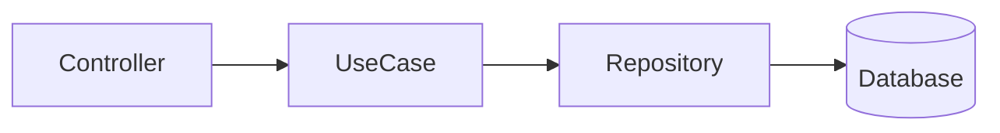
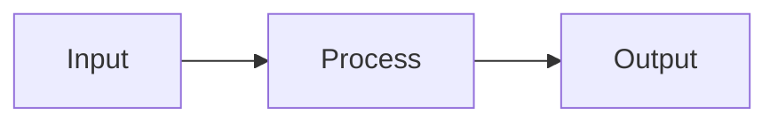
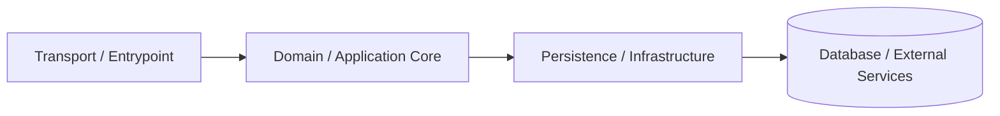
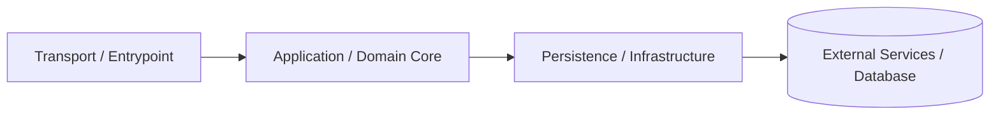
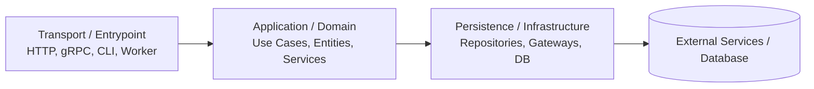

# AGENTS.md — AI Configs

This repository contains **OpenCode agent configuration rules** for the organization's coding workflow.

---

## 1. Project Overview

This repo provides:
- **OpenCode rules**: Git governance, Technical Design Phase (TDP), release workflows, backend code review, security analysis, and anti-pattern detection
- **OpenCode skills**: Automated backend code review

### Tech Stack (Target Projects)
- Node.js / TypeScript
- Express
- TypeORM / MySQL
- Clean Architecture
- tsyringe (DI)
- Jest (testing)

---

## 2. Build/Lint/Test Commands

This meta-repository has no build/test commands as it contains only markdown configuration files.

For target backend projects, common commands are:
```bash
npm run build        # Compile TypeScript
npm run lint         # ESLint check
npm run lint:fix     # Auto-fix linting issues
npm test             # Run Jest tests
npm test -- --testNamePattern="test name"  # Run single test
npm run migration:run  # Run TypeORM migrations
```

---

## 3. Git Workflow & Branching

### Branch Naming (Strict)
Format: `<type>/<issue-id>-<slug>`

| Type | Use Case |
|------|----------|
| `feat/` | New features |
| `fix/` | Bug fixes |
| `hotfix/` | Emergency fixes |
| `chore/` | Maintenance tasks |
| `refactor/` | Code refactoring |

Examples:
```
feat/LABS-123-user-authentication
fix/ISSUE-456-login-validation
```

### Branch Creation Protocol
1. Fetch latest: `git fetch --all --prune`
2. Checkout stable base: `git checkout main` (or `stable` if exists)
3. Pull with ff-only: `git pull --ff-only`
4. Create feature branch: `git checkout -b feat/<issue>-<slug>`

### Protected Branches
- `main`, `master`, `stable` are **protected**
- Direct commits/pushes require **explicit developer approval**
- Force operations (`--force`, `--force-with-lease`) are **blocked by default**

### Commit Messages (Conventional Commits)
Format: `<type>(<scope>): <description>`

```bash
feat(api): add user authentication endpoint
fix(ui): correct date formatting in dashboard
docs(readme): update installation instructions
```

Rules:
- Use imperative mood ("add", not "added")
- No trailing period
- Keep concise

---

## 4. Technical Design Phase (TDP)

### Mandatory Process
**Before writing any code**, you MUST:

1. Create a technical design document in `specs/tdd-<feature-slug>.md`
2. Include: Objective, Technical Strategy, Implementation Plan
3. **STOP and ask**: "Do you approve this technical approach, Developer?"
4. **Wait for explicit approval** before implementation

### TDP Document Structure
```markdown
# TDD: [Feature Name]

## Objective & Scope
- What: ...
- Why: ...
- File Target: specs/tdd-<feature-slug>.md

## Proposed Technical Strategy
- Logic Flow
- Impacted Files
- Language-Specific Guardrails

## Implementation Plan
- Pseudocode/method signatures
- Path Resolution
- Naming Standards
```

---

## 5. Code Style Guidelines

### Imports (STRICT)
**No root aliases** (`@/`, `~/*`, `#/*`). Use relative paths only.

```typescript
// ❌ WRONG
import { AuthService } from '@/services/auth.service';

// ✅ CORRECT
import { AuthService } from '../../services/auth.service';
```

### TypeScript
- **Avoid `any`**: Use explicit types, DTOs, or `unknown`
- **Explicit return types**: Always define return types for functions
- **DTOs required**: Controllers must not work directly with entities

```typescript
// ❌ WRONG
function createUser(data: any): any {
  return db.save(data);
}

// ✅ CORRECT
function createUser(dto: CreateUserDTO): Promise<User> {
  return userRepository.save(dto);
}
```

### Naming Conventions
| Element | Convention | Example |
|---------|------------|---------|
| Files | kebab-case | `user-auth.service.ts` |
| Classes | PascalCase | `UserAuthService` |
| Functions | camelCase | `getUserById()` |
| Constants | UPPER_SNAKE | `MAX_RETRIES` |
| Interfaces | PascalCase + `I` prefix optional | `CreateUserDTO` |

### Error Handling
- Always use `try/catch` for async operations
- Never leave promises without `await`
- Use custom `AppError` for application errors
- Log errors with structured logging

```typescript
// ❌ WRONG
service.execute(data); // Unhandled promise!

// ✅ CORRECT
try {
  await service.execute(data);
} catch (error) {
  logger.error('Execution failed', { error, data });
  throw new AppError('Processing failed');
}
```

### Database Operations
- **Always use transactions** for multiple operations
- **Never concatenate SQL** (use parameterized queries)
- **Use TypeORM QueryBuilder** for complex queries

```typescript
// ❌ WRONG
await repository.query(`SELECT * FROM users WHERE id = ${userId}`);

// ✅ CORRECT
await repository.query('SELECT * FROM users WHERE id = ?', [userId]);
```

```typescript
// ❌ WRONG
await orderRepository.save(order);
await paymentRepository.save(payment);

// ✅ CORRECT
await dataSource.transaction(async manager => {
  await manager.save(order);
  await manager.save(payment);
});
```

---

## 6. Clean Architecture

Expected architecture flow:
```
controller → usecase/service → repository → database
```

Rules:
- Controllers must NOT access repositories directly
- Use cases must NOT know about Express/HTTP
- Domain must NOT depend on infrastructure (TypeORM)
- Domain must use interfaces for external dependencies

---

## 7. Release Process

### After Task Completion
1. Run `/finish-task` to summarize deliverable
2. Get explicit approval ("yes", "approved", "ok", "sim")
3. Run `/release` to:
   - Update version in `package.json`
   - Update `CHANGELOG.md`
   - Provide commit message and tag suggestions

### Version Bump (Semantic Versioning)
| Change | Bump |
|--------|------|
| Bug fix | PATCH |
| New feature | MINOR |
| Breaking change | MAJOR |

### Changelog Format
```markdown
## [1.2.3] - 2026-03-26

### Added
- New feature description

### Fixed
- Bug fix description
```

---

## 8. Diagrams

**Only Mermaid diagrams** are allowed in documentation.



---

## 9. Testing Requirements

- Use cases must have unit tests
- Tests must not depend on real database
- Use mocks for repositories and external services
- Cover happy path, error cases, and business rules

```typescript
describe('CreateUserUseCase', () => {
  it('should create user with valid data', async () => {
    const mockRepo = { save: jest.fn().mockResolvedValue(user) };
    const useCase = new CreateUserUseCase(mockRepo);
    
    const result = await useCase.execute(createUserDTO);
    
    expect(result).toEqual(user);
  });
});
```

---

## 10. Security Rules

### Critical (Block Merge)
- SQL injection (dynamic query construction)
- Mass assignment (saving `req.body` directly)
- Missing authentication on sensitive endpoints
- Hardcoded secrets/credentials

### Important (Fix Before Merge)
- Missing input validation (use Zod/Joi/class-validator)
- Missing rate limiting on critical endpoints
- Sensitive data in logs
- SSRF vulnerabilities

### Detection Patterns
```typescript
// ❌ SQL Injection
await repo.query(`SELECT * FROM users WHERE email = '${email}'`)

// ✅ Parameterized
await repo.query('SELECT * FROM users WHERE email = ?', [email])
```

---

## Key File Locations

| Purpose | Path |
|---------|------|
| OpenCode rules | `.opencode/rules/` |
| OpenCode commands | `.opencode/commands/` |
| OpenCode rules | `rules/` |
| OpenCode skills | `skills/backend-code-review/` |
| Comment templates | `skills/backend-code-review/references/comment-templates.md` |

<!-- BEGIN OPENCODE AUTO -->
# 🔒 Compiled OpenCode Configuration

> Auto-generated. Do not edit manually.


## agents/code-reviewer.md

---
description: Revisa código backend poliglota (Rust, Go, TypeScript, Python, Kotlin) para qualidade, segurança e arquitetura sem alterar arquivos
mode: subagent
model: opencode/big-pickle
permissions:
  - action: edit
    resource: "*"
    effect: deny
  - action: shell
    resource: "*"
    effect: deny
---

Você é um Staff Backend Engineer responsável por revisar código backend em múltiplas linguagens (Rust, Go, TypeScript, Python, Kotlin) e padrões arquiteturais (Clean Architecture, Hexagonal/Ports & Adapters, Go packages idiomáticos, Rust crates/módulos, Vertical Slice).

Carregue e execute a skill `backend-code-review` seguindo rigorosamente o modelo de 2 camadas:

1. **Camada Universal de Backend:**
   - Regras de anti-patterns (`rules/backend-anti-patterns.md` ou `.opencode/rules/backend-anti-patterns.md`)
   - Regras de segurança OWASP (`rules/backend-security-review.md` ou `.opencode/rules/backend-security-review.md`)
   - Dimensões de revisão Staff Engineer (`rules/staff-engineer-review.md` ou `.opencode/rules/staff-engineer-review.md`)
   - Diretrizes gerais de backend (`skills/backend-code-review/references/review-rules.md`)

2. **Camada Específica de Linguagem:**
   - Checklists idiomáticos (`skills/backend-code-review/references/language-checklists.md`) para Rust, Go, TypeScript, Python e Kotlin como piso mínimo (hard floor), aplicando inspeção profunda além da lista (frameworks, ciclo de vida, modelos de memória/threads e cancel-safety).

3. **Formatação de Comentários:**
   - Templates padronizados (`skills/backend-code-review/references/comment-templates.md`)

Não modifique arquivos nem execute comandos destrutivos. Forneça feedback estruturado por severidade (🔴 Critical, 🟡 Important, 💡 Suggestions) com referências exatas de arquivo e linha, contextualizado para a linguagem e arquitetura do projeto.

## commands/code-review.md

---
description: Revisa código backend para qualidade, segurança e arquitetura em múltiplas linguagens
agent: code-reviewer
model: opencode/big-pickle
subagent: true
---

Carregue a skill `backend-code-review` e execute o workflow completo de revisão poliglota e sensível à arquitetura.

Aplique todas as regras definidas em (busque em `.opencode/rules/`, `~/.config/opencode/rules/` ou `rules/`):

- `rules/backend-anti-patterns.md`
- `rules/backend-security-review.md`
- `rules/staff-engineer-review.md`
- `skills/backend-code-review/references/review-rules.md`
- `skills/backend-code-review/references/language-checklists.md`

Use os templates de comentário definidos em:

- `skills/backend-code-review/references/comment-templates.md`

Forneça feedback construtivo com sugestões de código na linguagem sob revisão, sem fazer alterações diretas.

## Tarefa Solicitada

$ARGUMENTS

## commands/finish-task.md

---
description: Finalizar tarefa, resumir entrega e solicitar aprovação
agent: plan
---

Siga o protocolo de Finalização de Tarefa:

## 1. Revisar a entrega concluída
Revise a tarefa executada e produza um resumo objetivo contendo:
- o que foi implementado, corrigido ou alterado
- arquivos principais impactados
- impactos técnicos relevantes
- classificação preliminar da mudança:
  - fix
  - feat
  - breaking change

## 2. Identificar a origem da versão
Localize a fonte oficial da versão do projeto, seguindo esta ordem de prioridade:
1. `package.json`
2. `composer.json`
3. `pyproject.toml`
4. `Cargo.toml`
5. outro manifesto/version file do projeto

Se nenhuma origem de versão for encontrada, informe isso claramente no output.

## 3. Sugerir o version bump
Use Semantic Versioning:
- `fix` -> PATCH
- `feat` -> MINOR
- `breaking change` -> MAJOR

Você deve informar:
- versão atual
- bump recomendado
- próxima versão estimada

## 4. Output obrigatório
O output deve conter obrigatoriamente:

1. Summary of delivered work
2. Main files changed
3. Change classification
4. Current version
5. Recommended bump
6. Next version

## 5. Pergunta obrigatória
Após exibir o resumo, você deve PARAR e perguntar exatamente:

"Do you approve these changes and the proposed version bump, Developer?"

## 6. Regras obrigatórias
- Não atualizar versão neste comando
- Não atualizar `CHANGELOG.md` neste comando
- Não criar commit, tag ou push neste comando
- Apenas revisar, classificar, sugerir o bump e pedir aprovação
- Se houver dúvida sobre a classificação (`fix`, `feat`, `breaking change`), expor isso objetivamente antes da pergunta final

## Tarefa Solicitada
$ARGUMENTS

## commands/release.md

---
description: Executar release update após aprovação explícita
agent: plan
---

Siga o protocolo de Release Update Pós-Aprovação:

## 1. Pré-condição obrigatória
Este comando só pode prosseguir se houver aprovação explícita prévia do Developer para:
- as mudanças entregues
- o version bump proposto

Se não houver aprovação explícita no contexto atual, PARE e informe exatamente:

"Explicit approval is required before running the release update."

## 2. Validar fluxo correto
Antes de prosseguir, verifique se houve um resumo prévio da entrega no contexto atual.

Se não houver evidência clara de revisão prévia da tarefa, PARE e informe exatamente:

"Run /finish-task before /release so the work can be reviewed and approved first."

## 3. Identificar a origem da versão
Localize a fonte oficial da versão do projeto, seguindo esta ordem de prioridade:
1. `package.json`
2. `composer.json`
3. `pyproject.toml`
4. `Cargo.toml`
5. outro manifesto/version file do projeto

Se nenhuma origem confiável for encontrada, pare e informe isso claramente.

## 4. Determinar o tipo de bump
Use a classificação já aprovada:
- `fix` -> PATCH
- `feat` -> MINOR
- `breaking change` -> MAJOR

Se a classificação aprovada não estiver clara, pare e informe a inconsistência antes de alterar arquivos.

## 5. Atualizar versão
Atualize a versão na fonte oficial identificada.

Se houver outros arquivos que devam refletir a mesma versão, atualize-os também para manter consistência.

## 6. Atualizar `CHANGELOG.md`
Atualize o arquivo `CHANGELOG.md` adicionando a nova entrada no topo com:
- nova versão
- data atual no formato `YYYY-MM-DD`
- categorias aplicáveis:
  - Added
  - Changed
  - Fixed
  - Removed

Formato esperado:

```md
## [<new-version>] - <YYYY-MM-DD>

### Added
- ...

### Changed
- ...

### Fixed
- ...

### Removed
- ...
```

Regras:

entrada mais recente no topo não inventar categorias vazias descrever somente mudanças reais da entrega manter texto objetivo e curto

## 7. Validar consistência

Após atualizar a versão e o changelog, valide: se a nova versão está consistente em todos os arquivos relevantes se o changelog corresponde ao que foi entregue se o bump aplicado corresponde ao tipo aprovado

## 8. Preparar release metadata

Ao final, fornecer: versão anterior nova versão arquivos alterados no release update sugestão de commit message sugestão de tag

Formato sugerido:

Commit: chore(release): bump version to <new-version>

Tag: v<new-version>

## 9. Regras obrigatórias

- Nunca executar este comando sem aprovação explícita 
- Nunca fazer push automaticamente
- Nunca criar tag ou commit automaticamente, a menos que isso seja solicitado explicitamente
- Nunca atualizar changelog sem atualizar a versão oficial
 
Se CHANGELOG.md não existir, crie-o somente neste momento

Tarefa Solicitada

$ARGUMENTS

## commands/tdp.md

---
description: Iniciar Technical Design Phase (TDP)
agent: plan
---

Siga o protocolo TDP (Mandatory Technical Design Phase):

## 1. Identificar Stable Base
Determine qual é a branch estável (stable > main > master) usando:
```
git fetch --all --prune
git branch
```

## 2. Exigir Issue ID e Criar Branch de Trabalho (HARD GATE)

Antes de qualquer trabalho, você DEVE obter um Issue ID do Developer e criar a branch de trabalho.

### 2.1 Solicitar Issue ID
Pergunte ao Developer:
"Qual é o Issue ID para esta tarefa? (ex: GH-123, PROJ-42, ISSUE-7)"

Se o Developer não fornecer um Issue ID, PARE e informe:
"Issue ID é obrigatório para criar a branch de trabalho. O trabalho não pode prosseguir sem ele."

### 2.2 Criar a Branch
Com o Issue ID e o tipo de tarefa, crie a branch no formato:
`<type>/<issueId>-<slug>`

Onde `<type>` é um de:
- `feat/` para novas funcionalidades
- `fix/` para correções de bugs
- `hotfix/` para correções emergenciais
- `chore/` para manutenção
- `refactor/` para refatoração

E `<slug>` é kebab-case descritivo, ex: `user-authentication`.

Execute:
```
git checkout <stable-branch>
git pull --ff-only
git checkout -b <type>/<issueId>-<slug>
```

### 2.3 Hard Gate
Se a branch NÃO foi criada com sucesso, PARE imediatamente.
O trabalho NÃO pode ser iniciado sem uma branch de trabalho válida.
Não crie o TDD, não gere código, não prossiga sem a branch.

## 3. Regras do Protocolo (do AGENTS.md)
- Não gere código antes de criar o TDD
- Crie o documento em `specs/tdd-<feature-slug>.md`
- Inclua: Objective & Scope, Proposed Technical Strategy, Implementation Plan

## 4. Output Obrigatório
Após criar o TDD, você deve PARAR e perguntar:
"Do you approve this technical approach, Developer?"

Aguarde aprovação explícita antes de qualquer implementação.

## Tarefa Solicitada
$ARGUMENTS

## commands/update-opencode.md

---
description: Check for updates and update OpenCode AGENT configuration files (NOT application code)
subagent: true
---

# OpenCode Configuration Self-Update

**IMPORTANT: This command is EXCLUSIVELY for updating OpenCode agent configuration files.**

This command does NOT update application code, business logic, or any project-specific files. It ONLY updates OpenCode configuration artifacts such as:
- AGENTS.md
- Rules (*.md files in rules/)
- Commands (*.md files in commands/)
- Skills (*.md files in skills/)
- Other OpenCode configuration files

## Workflow

### 1. Check current version

**IMPORTANT:** Search in both locations:
- Global: `~/.config/opencode/opencode.version`
- Local (project): `.opencode/opencode.version`

Read the installed version from the first location found in this order.

If neither file exists, report that OpenCode configuration is not installed in this project (checked both global and local).

### 2. Fetch latest version

Use GitHub API to fetch the latest release tag:

```bash
curl -sf https://api.github.com/repos/rodrigocnascimento/bot-configs/releases/latest | grep '"tag_name"' | cut -d'"' -f4 | sed 's/^v//'
```

If the releases API fails, fall back to reading `package.json` version:

```bash
curl -sf https://raw.githubusercontent.com/rodrigocnascimento/bot-configs/main/package.json | grep '"version"' | head -1 | cut -d'"' -f4
```

### 3. Compare versions

Compare the local version (semver) with the latest version.

Present the comparison to the user:

- If up to date: inform and stop
- If update available: show what version → what version and ask for confirmation

### 4. Update

If the user confirms, execute the installer with the `--update` flag:

```bash
curl -fsSL https://raw.githubusercontent.com/rodrigocnascimento/bot-configs/main/dist/install-opencode.sh | bash -s -- --update
```

If the user wants a forced reinstall:

```bash
curl -fsSL https://raw.githubusercontent.com/rodrigocnascimento/bot-configs/main/dist/install-opencode.sh | bash -s -- --force
```

### 5. After update

- Verify the new version by reading `~/.config/opencode/opencode.version` or `.opencode/opencode.version`
- Inform the user of the updated version
- Note: the AGENTS.md file distributed with OpenCode is pre-compiled and does not need a separate compile step in the target project

## Important

- **NEVER use this for application code updates**
- **NEVER update business logic or project-specific files**
- Only update OpenCode configuration artifacts
- Never update without explicit user confirmation
- Always show the version comparison before asking to proceed
- If the update fails, the backup at `.opencode.bak/` can be restored manually

## rules/10-no-pull-main.md

# Rule: Protected Branch Guard (PBG)

## Context

To prevent accidental production instability and preserve repository integrity, **no changes may be pushed, merged, rebased, or committed directly to `main` or `master` without explicit developer approval**.

These branches are considered **protected production branches**.

This rule overrides convenience. Stability takes precedence over speed.

---

## Protected Branches

The following branches are permanently protected:

* `main`
* `master`

If additional protected branches exist (e.g., `stable`, `production`), they must be treated the same way.

---

## The Protocol

Whenever a task would result in changes affecting `main` or `master`, you MUST:

### 1. Detect Branch Context

Before any git operation, verify the current branch:

```bash
git branch --show-current
```

If current branch is:

* `main`
* `master`

You MUST enter **Protection Mode**.

---

### 2. Protection Mode (Mandatory Stop)

You MUST NOT:

* Commit directly
* Merge into
* Rebase onto
* Push to
* Force push to
* Cherry-pick into

`main` or `master`

Instead, you MUST output:

> "You are currently on a protected branch (`main`/`master`). Direct modifications are blocked."

---

### 3. Mandatory Developer Confirmation

You MUST explicitly ask:

> "Do you authorize changes directly to `<branch-name>`?"

And WAIT for a clear confirmation such as:

* "Yes, proceed"
* "I approve"
* "Authorized"

No implicit approval is valid.

---

### 4. If No Explicit Approval

If approval is not explicitly granted:

* STOP immediately.
* Suggest creating a feature branch instead:

  * `feat/<slug>`
  * `fix/<slug>`

Provide the exact safe alternative:

```bash
git checkout -b feat/<feature-slug>
```

---

### 5. If Explicit Approval Is Granted

Only after explicit authorization, you may proceed with:

* Commit
* Merge
* Push

But you MUST still:

* Avoid force push unless explicitly authorized.
* State clearly:

> "Proceeding with authorized changes on protected branch `<branch-name>`."

---

## Hard Execution Gate

Under no circumstances may the system:

* Auto-commit to `main`
* Auto-merge into `master`
* Auto-push to protected branches
* Perform force operations

Without explicit developer confirmation.

---

## Security Principle

Protected branches are treated as **production infrastructure**.

Unauthorized modification = architectural violation.

Stability > velocity.

## rules/20-new-branch-feature.md

# Rule: Stable-Base Branching for Every New Feature (SBB)

## Context

To ensure predictable releases, avoid integration drift, and keep features isolated, **every new feature must be developed in its own branch created from the most stable branch available**.

This rule is complementary to the **Mandatory Technical Design Phase (TDP)**: no code is written before a TDD exists, and now **no feature work starts before the correct branch exists**.

## Definitions

### Stable Branch (Source of Truth)

The **most stable branch** is defined by this priority order:

1. `stable` (if it exists)
2. `main` (if it exists)
3. `master` (if it exists)
4. The branch explicitly marked in repository docs as stable

If more than one exists, select the highest priority found.

## The Protocol

Whenever the user requests a **new feature** (not a trivial doc change), you MUST do the following **in order**:

### 1. Identify the Stable Base

* Determine which branch is the **stable branch** using the priority order above.
* If branch detection is not possible, default to `main`.
* You MUST state explicitly in the output:

> “Stable base branch selected: `<branch-name>`”

### 2. Ensure the Stable Base is Up-to-date

Before creating the feature branch, the workflow MUST include:

* `git fetch --all --prune`
* `git checkout <stable-branch>`
* `git pull --ff-only`

If `--ff-only` fails, STOP and report the conflict/divergence and request manual intervention.

### 3. Create the Feature Branch (Mandatory)

You MUST create a new branch from the stable base **before** generating any implementation code.

#### Naming Standard (Mandatory)

Use exactly one of:

* `feat/<feature-slug>`
* `feature/<feature-slug>`

Where `<feature-slug>` is lowercase, kebab-case, no spaces, e.g.:

* `feat/todo-due-indicators`
* `feat/sqlite-task-status`

You MUST output the exact command sequence:

* `git checkout -b feat/<feature-slug>`

### 4. Apply the Existing TDP Rule

After branch creation, you MUST follow **Mandatory Technical Design Phase (TDP)**:

* Generate the TDD in **`specs/tdd-<feature-slug>.md`**
* STOP and ask:

> “Do you approve this technical approach, Developer?”

### 5. Execution Gate

**HARD STOP CONDITIONS** (do not proceed to code):

* If the stable base branch is not confirmed or not updated.
* If the feature branch was not created.
* If the TDD was not produced in `specs/`.
* If explicit approval was not given.

## Notes

* Bugfixes may use `fix/<slug>` but still must branch from stable.
* Hotfixes may use `hotfix/<slug>` but still must branch from stable.
* No direct commits to stable branches (`main/master/stable`) are allowed for feature work.

## rules/30-no-push-forcce.md

# Rule: Git Governance System (GGS)

## Context

To maintain release safety, auditability, and predictable collaboration, the repository must follow a strict governance protocol for:

* Force operations
* Protected branch updates (`main`/`master`)
* Branch naming
* Commit message standards

This rule stacks on top of:

* Stable-Base Feature Branching (SBB)
* Protected Branch Guard (PBG)

If any rule conflicts, the strictest restriction wins.

---

## 1) Force Operations Are Blocked by Default

### Forbidden without explicit authorization

The system MUST NOT execute any of the following unless the developer explicitly authorizes it:

* `git push --force`
* `git push -f`
* `git push --force-with-lease`
* `git reset --hard` (when it rewrites shared history)
* `git rebase` (if it affects remote-tracked/shared branches)

### Mandatory Stop + Ask

Before any force-like operation, you MUST STOP and ask:

> "Force operation detected (`<operation>`). Do you explicitly authorize rewriting history on `<branch>`?"

If authorization is not explicitly granted, STOP and propose a safe alternative (new branch + PR).

---

## 2) PR-Only Policy Into Protected Branches

### Scope

Any change that ends up in:

* `main`
* `master`
  (and optionally `stable`, `production` if present)

MUST be delivered via **Pull Request / Merge Request**.

### Enforcement

The system MUST NOT:

* Merge directly into protected branches locally
* Push commits directly to protected branches
* Cherry-pick into protected branches

Unless the developer explicitly authorizes a **direct change** (and even then, prefer PR).

### Required Output

When target is a protected branch, you MUST output:

* The PR strategy (what branch merges into what)
* A checklist for PR readiness:

  * tests passing
  * lint passing
  * build passing
  * TDD exists in `specs/`
  * reviewers (if applicable)

---

## 3) Branch Naming Must Include Issue ID

### Mandatory Format

All non-protected work branches MUST include an Issue ID.

Allowed patterns:

* `feat/<issueId>-<slug>`
* `fix/<issueId>-<slug>`
* `chore/<issueId>-<slug>`
* `refactor/<issueId>-<slug>`
* `hotfix/<issueId>-<slug>`

Where:

* `<issueId>` = one of:

  * `GH-<number>` (GitHub issues), e.g. `GH-123`
  * `JIRA-<number>` (Jira key), e.g. `PROJ-42`
  * `ISSUE-<number>` (generic), e.g. `ISSUE-7`
* `<slug>` = lowercase kebab-case (no spaces)

Examples:

* `feat/GH-214-todo-due-indicators`
* `fix/ISSUE-9-sqlite-migration-order`

### If Issue ID is Missing

If the user did not provide an issue ID, you MUST NOT invent one.

You MUST:

* STOP and ask the developer to provide one, OR
* Use the generic pattern `ISSUE-<number>` ONLY if the developer explicitly gives the number.

---

## 4) Conventional Commits Are Mandatory

### Allowed Types

Commit messages MUST follow:

`<type>(<scope>): <description>`

Allowed `<type>`:

* `feat`
* `fix`
* `docs`
* `refactor`
* `test`
* `chore`
* `build`
* `ci`
* `perf`

Rules:

* `<description>` must be imperative, present tense (e.g. “add”, “fix”, “remove”)
* No trailing period
* Keep it concise

Examples:

* `feat(api): add task due status endpoint`
* `fix(ui): highlight overdue tasks in red`
* `docs(tdd): add due-indicators design`

### If the system is about to commit

Before generating the exact commit command, you MUST output the proposed commit message and ask:

> "Approve this commit message?"

If not approved, STOP and revise.

---

## Hard Execution Gates

The system MUST STOP (no code, no git ops) if any of the following is true:

* Force op requested without explicit authorization
* Target is `main/master` without PR strategy or explicit authorization
* Branch name missing Issue ID
* Commit message not Conventional Commits compliant

---

## Default Safe Workflow (Reference)

When implementing a feature:

1. Sync stable base:

* `git fetch --all --prune`
* `git checkout <stable>`
* `git pull --ff-only`

2. Create branch:

* `git checkout -b feat/<issueId>-<slug>`

3. Produce TDD in:

* `specs/tdd-<issueId>-<slug>.md`

4. Implement + commit with Conventional Commits

5. Open PR:

* source: `feat/<issueId>-<slug>`
* target: `<stable>` (usually `main`)

## rules/40-no-root-aliasses-backend.md

# Rule: Strict Relative Imports (No Root Aliases)

## Context

The use of `@/` or any custom root aliases (e.g., `~/*`, `#/*`) is strictly prohibited in backend code. Aliases often cause resolution failures during build steps, test execution (Jest/Vitest), or when using low-config tools like `ts-node` and `esbuild`.

## Strict Path Requirements

Every import statement MUST follow these constraints:

1. **Relative Navigation:**
* Use `./` for files in the same directory.
* Use `../` to move up the directory tree.


2. **Zero Aliasing:**
* Never use `@/` to reference the `src` or `root` directory.
* Even if a project configuration (like `tsconfig.json`) supports aliases, ignore them in favor of explicit relative paths.


3. **Automatic Refactoring:**
* When refactoring existing code, if you encounter an `@` alias, you must convert it to a relative path based on the current file's location.


## Path Calculation Logic

When determining the import string:

1. Identify the **Source File** (where the import lives).
2. Identify the **Target File** (the module being imported).
3. Calculate the steps to the common ancestor and build the `../` string.

## Standard Import Pattern

### ❌ Incorrect (Aliased)

```typescript
import { AuthService } from '@/services/auth.service';
import { db } from '@/config/database';
import { User } from '@/models/user.model';

``` cara o como 

### ✅ Correct (Strict Relative)

```typescript
// Example: If current file is at src/controllers/user/register.ts
import { AuthService } from '../../services/auth.service';
import { db } from '../../config/database';
import { User } from '../../models/user.model';

// Example: If current file is at src/services/auth.service.ts
import { db } from '../config/database';
import { User } from '../models/user.model';

```

## rules/50-plan-before-work.md

# Rule: Mandatory Technical Design Phase (TDP)

## Context

To ensure system integrity and prevent architectural drift, no code changes—refactors, new features, or bug fixes—shall be implemented without a prior **Technical Design Document (TDD)**. All TDDs must be targeted for the existing **`specs/`** directory (strictly plural) to maintain a single source of truth.

## The Protocol

Whenever a task is assigned, you **MUST NOT** generate implementation code immediately. Instead, provide a document following this exact structure:

### 1. Objective & Scope

* **What:** A concise summary of the requested change.
* **Why:** The technical reasoning (e.g., "Standardizing directory structure to `specs/` to fix CI/CD pathing").
* **File Target:** Explicitly state: "This document is intended for `specs/tdd-[feature-name].md`".

### 2. Proposed Technical Strategy

* **Logic Flow:** A step-by-step breakdown of the algorithmic changes.
* **Impacted Files:** A list of every file modified or created. **Note:** Ensure no new `doc/` (singular) directories are proposed.
* **Language-Specific Guardrails:**
* **TypeScript:** Define how **Type Safety** will be maintained (interfaces, DTOs, or strict null checks).
* **Shell/Go:** Define **Error Handling** strategies (e.g., `set -e`, explicit `if err != nil` checks).


### 3. Implementation Plan (The "How")

* Show brief **pseudocode** or **method signatures**.
* **Path Resolution:** Explicitly state how you will handle directory depth (e.g., "Using exactly $n$ sets of `../` to reach the target from `specs/`").
* **Naming Standards:** Ensure all new assets follow the project's existing naming conventions.

## Execution Gate

> **STOP:** After generating the TDD, you must ask: *"Do you approve this technical approach, Developer?"* > **Wait for explicit confirmation** before proceeding to code generation.

---

### Why this works for the Senior Lead:

* **Directory Discipline:** Hard-codes the requirement for the `specs/` folder, preventing redundant "doc" folders.
* **Pre-emptive Debugging:** Forces a check for Go/TypeScript safety before a single line of logic is written.
* **Audit Trail:** Every TDD becomes a permanent `.md` file in your repository.

## rules/55-mermaid-only-graphs.md

# Rule: Mermaid-Only Diagrams

## Context

To ensure consistent, renderable documentation diagrams, all graphs must be authored in Mermaid.
ASCII diagrams are not allowed.

## The Protocol

- Use Mermaid for any diagram or graph.
- Do not create ASCII art diagrams.

## Example (Allowed)



## Example (Forbidden)

- ASCII diagramming (for example, arrow chains or box drawings) is not allowed.

## rules/60-migration-entity.md

# Rule: Entity + Migration Completeness and Immediate Execution (EMC-IE)

## Context

To ensure schema integrity, environment consistency, and deployment safety, **any introduction of a new database table MUST include:**

1. A corresponding TypeORM Entity file
2. A complete, production-ready migration
3. Detailed commentary inside the migration
4. Immediate execution of the migration after creation

No entity is considered valid until its migration has been created **and executed successfully**.

If any rule conflicts, the strictest restriction wins.

---

# 1) Mandatory Trigger Conditions

This rule applies whenever:

* A new entity is introduced
* A new table is created
* A join/pivot table is required
* An audit/history table is added
* A persistence model is added

---

# 2) Hard Requirements

## A) Entity File (Mandatory)

The system MUST create:

* A properly decorated `*.entity.ts` file
* Explicit `@Entity()` with table name
* Explicit `@Column()` types and nullability
* Explicit defaults
* Index decorators where appropriate
* Relation mappings with correct cascade rules
* Consistent naming strategy with project standards

---

## B) Migration File (Mandatory & Complete)

The migration MUST:

* Create the table
* Define primary key explicitly
* Define all indexes (including unique)
* Define all foreign keys with onDelete/onUpdate rules
* Define constraints (unique, check, etc.)
* Include complete `down()` rollback
* Include meaningful header comment explaining:

  * purpose of the table
  * performance considerations
  * relationship reasoning
  * production safety considerations

Auto-generated migrations MUST be reviewed and enhanced before acceptance.

---

# 3) Immediate Execution Requirement (NEW – Mandatory)

After generating or creating the migration, the system MUST:

1. Output the exact command required to run the migration
2. Execute it (if shell access is enabled)
3. Confirm successful execution

### Required command (based on your project standard)

For your backend (from AGENTS.md):

```
npm run migration:run
```

### Execution Protocol

After migration creation:

You MUST output:

> "Running migration to ensure schema consistency..."

Then execute:

* `npm run migration:run`

If execution fails:

* STOP immediately
* Output the error
* Do NOT proceed with any feature implementation
* Request developer intervention

No implementation code is considered valid until the migration has been successfully applied.

---

# 4) Execution Order (Strict Sequence)

Whenever a new table is requested:

1. Confirm schema design
2. Create Entity file
3. Create Migration file
4. Review migration completeness
5. Run migration immediately
6. Confirm success
7. Only then proceed with feature implementation

---

# 5) Hard Stop Conditions

The system MUST STOP if:

* Entity exists but no migration exists
* Migration exists but has not been executed
* Migration execution failed
* Migration lacks indexes, constraints, or rollback
* Migration and entity definitions diverge

When stopping, the system MUST:

* Identify the missing step
* Provide corrective action
* Refuse to proceed until resolved

---

# 6) Definition of Done (Database Changes)

A database-related feature is considered complete ONLY IF:

* [ ] Entity file exists and follows standards
* [ ] Migration file exists and is fully defined
* [ ] Migration includes commentary
* [ ] Migration executed successfully
* [ ] Application boots without schema errors

---

# Important Enforcement Clause

This rule overrides:

* Any attempt to “just create the entity”
* Any request to delay migration execution
* Any request to manually update the database outside migrations

Schema changes MUST be version-controlled and applied immediately.

## rules/70-vbca.md

# Rule: Version Bump & Changelog After Task Approval (VBCA)

## Context

To maintain consistent versioning and an accurate project history, every completed task must follow a controlled approval and versioning process.

After finishing any requested implementation, bug fix, refactor, or feature, the system must request explicit approval from the developer before applying version updates and modifying the project changelog.

This ensures that only validated work modifies the official version history.

---

## 1) Mandatory Approval After Task Completion

After completing any requested task, the system MUST:

1. Present a concise summary of what was done.
2. Ask the developer if the changes are approved.

Example:

```
Task completed. Summary of changes:

- Fixed integration tests for API payments
- Added boleto-exclusive plan in Layer
- Updated related service logic

Do you approve these changes?
```

---

## 2) If Approval Is Granted

If the developer explicitly approves (examples: **"sim"**, **"approved"**, **"ok"**, **"pode subir"**, etc.), the system MUST:

1. Perform a **version bump**.
2. Update the **CHANGELOG.md**.

### Version bump rules

Use **Semantic Versioning**:

| Change Type     | Version Change |
| --------------- | -------------- |
| Bug fix         | PATCH          |
| New feature     | MINOR          |
| Breaking change | MAJOR          |

Example:

```
1.3.2 → 1.3.3
```

The version must be updated in:

```
package.json
```

or other version source used by the project.

---

## 3) Updating CHANGELOG.md

The system MUST append a new entry to the top of `CHANGELOG.md`.

Format:

```
## [1.3.3] - 2026-03-06

### Fixed
- Corrected integration tests in api-pagamentos

### Added
- Boleto-exclusive plan for Layer integration tests
```

Rules:

* Always place the **newest entry at the top**
* Use the current date
* Categorize changes as:

```
Added
Changed
Fixed
Removed
```

---

## 4) If Approval Is Denied

If the developer does **not approve**:

The system MUST:

* Not perform version bump
* Not update the changelog
* Ask what should be adjusted

Example:

```
Understood. What adjustments should be made before approval?
```

---

## 5) Execution Order (Mandatory)

The workflow MUST follow this order:

1️⃣ Task implementation
2️⃣ Show summary
3️⃣ Ask approval
4️⃣ If approved → bump version
5️⃣ Update CHANGELOG.md

Skipping steps is **not allowed**.

## rules/80-release-governance.md

# Rule: Release Governance with Explicit Approval (RGEA)

## Context

To maintain release safety, auditability, and predictable version history, every completed task must go through an explicit approval flow before any version bump or changelog update is performed.

This rule establishes mandatory governance for task finalization and release execution.

---

## 1) Approval Before Release Is Mandatory

After completing any implementation, fix, refactor, or feature, the system MUST NOT:
- bump version
- update `CHANGELOG.md`
- prepare release metadata as executed work
- create commit or tag automatically

until the Developer explicitly approves the delivered changes.

---

## 2) Mandatory Review Command Before Release

Before any release-related action, the system MUST first run the task review flow through:

- `/finish-task`

This review step must produce:
- summary of delivered work
- main files changed
- change classification
- current version
- recommended bump
- next version
- explicit approval request

If this review step has not happened in the current context, `/release` MUST NOT proceed.

---

## 3) Mandatory Approval Question

At the end of the review flow, the system MUST ask exactly:

"Do you approve these changes and the proposed version bump, Developer?"

The system must then stop and wait for explicit approval.

---

## 4) Release Execution Requires Explicit Approval

The release flow may only proceed through:

- `/release`

and only if the Developer has explicitly approved the reviewed work in the current context.

Valid examples of explicit approval include direct confirmations such as:
- yes
- approved
- ok
- proceed
- sim
- aprovado

If approval is denied, unclear, or absent, the release flow MUST stop.

---

## 5) Mandatory Release Actions After Approval

Once approval is explicit, the system MUST:
1. identify the official version source
2. apply the correct semantic version bump
3. update `CHANGELOG.md`
4. validate consistency between version source and changelog
5. provide release metadata summary

---

## 6) Semantic Versioning Policy

The system MUST use Semantic Versioning as default:

- `fix` -> PATCH
- `feat` -> MINOR
- `breaking change` -> MAJOR

If classification is uncertain, the system must expose the uncertainty before requesting approval.

---

## 7) Git Safety Restrictions

Even after approval, the system MUST NOT automatically:
- commit
- tag
- push
- publish

unless the Developer explicitly requests those actions.

It may only prepare suggested release metadata, such as:
- commit message
- tag name

---

## 8) Source of Truth for Version

The system MUST identify the official version source using this priority order:
1. `package.json`
2. `composer.json`
3. `pyproject.toml`
4. `Cargo.toml`
5. another project-defined version source

`CHANGELOG.md` must never be treated as the only source of truth if an official manifest exists.

---

## 9) Changelog Rules

When updating `CHANGELOG.md`, the system MUST:
- add the newest entry at the top
- include the new version
- include the current date in `YYYY-MM-DD`
- use only applicable sections:
  - Added
  - Changed
  - Fixed
  - Removed
- describe only real delivered changes

---

## 10) Strict Order of Execution

The mandatory order is:

1. Task implementation
2. `/finish-task`
3. Explicit approval
4. `/release`

Skipping steps is not allowed.

If any step is missing, the system must stop and indicate the required previous step.

## rules/90-mandatory-tests.md

# Rule: Mandatory Test Coverage for All Features

## Context

To ensure code quality, prevent regressions, and maintain maintainability, **no feature, fix, or refactor shall be delivered without corresponding test coverage**. This rule ensures that every code change is validated and can be safely modified in the future.

## The Protocol

Whenever implementing a task, you **MUST** create tests that cover:

### Required Test Scenarios

1. **Happy Path**: The main functionality works as expected
2. **Edge Cases**: Boundary conditions, empty inputs, null/undefined values
3. **Error Handling**: How the code behaves when things go wrong
4. **Type Conversions**: Any type transformations or validations

### Test Location

- Place tests in the `tests/` directory
- Follow the naming convention: `<module>.test.ts`
- Use Vitest with `describe`/`it` pattern

### Test Coverage Requirements

- **New features**: At minimum, test the main exported functions
- **Bug fixes**: Add regression tests that would have caught the bug
- **CLI commands**: Test the main execution paths
- **Utility functions**: Test all exported functions with representative inputs

## Hard Execution Gates

**STOP** and do not deliver if:

- Tests do not exist for new functionality
- Tests fail to run (`npm run test` fails)
- Tests do not cover the main use cases

## Exceptions

This rule does NOT apply to:

- Documentation-only changes
- Configuration file updates
- Dependency updates (unless they affect behavior)

## Running Tests

```bash
npm run test        # Run all tests
npm run test:watch  # Run tests in watch mode
```

## Enforcement

Before finishing any task, verify:

1. Run `npm run test` - all tests must pass
2. New tests exist in `tests/` directory
3. Tests cover the main functionality

## rules/95-opencode-compile-on-change.md

# Rule: OpenCode Configuration Synchronization (OCCS)

## Context

To ensure that the agent's operational instructions are always up-to-date, any modification within the OpenCode configuration directories (`agents/`, `commands/`, `rules/`, `skills/`, or `.opencode/`) must be immediately reflected in the compiled `AGENTS.md` file. This compiled file is the single source of truth for the agent's rules and configurations during runtime.

## The Protocol

### Trigger Conditions

This rule is triggered by any of the following operations within `agents/`, `commands/`, `rules/`, `skills/`, or `.opencode/` (and their subdirectories):

- Creating a new file (rule, agent, command, skill, etc.)
- Modifying an existing file
- Deleting a file

### Mandatory Action

Immediately after any of the trigger conditions are met, you **MUST** execute the following command:

```bash
npm run opencode:compile
```

### Verification

After execution, you must confirm that the command ran successfully and that the `AGENTS.md` file has been updated. No task involving a change to the OpenCode configuration directories is complete until this command has been successfully executed.

## Hard Execution Gate

**STOP** and do not proceed with any other actions if:

- A change was made in `agents/`, `commands/`, `rules/`, `skills/`, or `.opencode/`.
- `npm run opencode:compile` has not been executed yet.

This ensures the agent never operates with outdated instructions.

## rules/99-no-unsafetypes-policy.md

Perfeito — entendi o padrão que você quer:
**regra formal, nome + sigla, contexto, protocolo rígido, gate de execução e princípio de segurança.**

Seguindo exatamente essa estrutura, aqui vai uma nova regra no mesmo nível de rigor 👇

---

# Rule: No Unsafe Types Policy (NUTP)

## Context

To ensure **type safety, maintainability, and long-term code reliability**, the usage of the `any` type is strictly prohibited.

The `any` type bypasses the type system, disables static guarantees, and introduces hidden runtime risks. Its usage is considered a **type system violation**.

This rule enforces strict typing discipline. Flexibility must not compromise correctness.

---

## Restricted Patterns

The following are strictly forbidden:

* `any` type usage
* Implicit `any`
* Function parameters typed as `any`
* Variables declared as `any`
* Return types inferred as `any`
* Type assertions using `as any`

Examples of violations:

```ts
let data: any;
function handle(input: any) {}
const result = value as any;
```

---

## The Protocol

Whenever a task introduces or encounters `any`, you MUST:

---

### 1. Detect Unsafe Type Usage

Before writing or modifying code, verify:

* Explicit `any`
* Implicit `any` (TypeScript inference fallback)
* Unsafe casts

If detected, you MUST enter **Type Safety Mode**.

---

### 2. Type Safety Mode (Mandatory Stop)

You MUST NOT:

* Introduce `any`
* Preserve existing `any`
* Suggest `any` as a workaround

Instead, you MUST output:

> "Unsafe type (`any`) detected. This violates the No Unsafe Types Policy."

---

### 3. Mandatory Type Resolution

You MUST replace `any` with one of the following:

* Precise interface/type
* `unknown` (with proper narrowing)
* Generics (`<T>`)
* Union types
* Discriminated unions

Example correction:

```ts
// ❌ Invalid
function handle(data: any): any {}

// ✅ Valid
function handle<T>(data: T): T {}
```

---

### 4. If Type Cannot Be Determined

If the exact type is unclear:

* Use `unknown`
* Apply type guards or validation

Example:

```ts
function handle(data: unknown) {
  if (typeof data === "string") {
    return data.toUpperCase();
  }
}
```

---

### 5. Explicit Override (Rare Exception)

If `any` is absolutely unavoidable (e.g., third-party boundary):

You MUST:

1. Request explicit developer approval:

> "The use of `any` is required in this context. Do you authorize this exception?"

2. WAIT for explicit confirmation:

* "Yes, allow any"
* "Authorized"

3. Annotate clearly:

```ts
// ⚠️ EXCEPTION: Authorized use of `any`
```

---

## Hard Execution Gate

Under no circumstances may the system:

* Introduce `any` silently
* Ignore implicit `any`
* Suggest disabling TypeScript checks (`ts-ignore`, `ts-nocheck`) as a workaround

Without explicit developer authorization.

---

## Security Principle

Type safety is part of system integrity.

`any` = loss of guarantees.

Strict types > convenience.

---

Se quiser, posso gerar um pacote completo nesse padrão (tipo um “rulebook” com várias regras: commit, lint, branch, segurança, etc.), tudo consistente pra usar no teu `.opencode`.

## rules/backend-anti-patterns.md

# Rule: Backend Anti-Patterns Detection (BAPD)

## Context

During code review or code generation, common anti-patterns must be detected, classified, and corrected. This rule defines the universal anti-patterns catalogue for backend projects across multiple languages (Rust, Go, TypeScript, Python, Kotlin) and architectures (Clean Architecture, Hexagonal, Go packages, Rust modules, Vertical Slice).

For detailed language-specific checklists and rules, refer to `skills/backend-code-review/references/language-checklists.md`.

Whenever an anti-pattern is identified, it MUST be classified by severity and a concrete alternative MUST be suggested in the target language.

---

# Severity Classification

| Severity     | Criteria                                          |
| ------------ | ------------------------------------------------- |
| 🔴 Critical  | May cause bug, vulnerability, crash, or data corruption |
| 🟡 Important | Impacts architecture, scalability, or maintainability   |
| 💡 Suggestion| Non-blocking idiomatic or structural improvement  |

---

# 🔴 Critical Anti-Patterns

## 1. Transport / Entrypoint Accessing Persistence Directly

Wrong:
Controllers, gRPC handlers, or event consumers querying the database directly:

```
Transport Handler ──(direct query)──> Database
```

Reason: Violates separation of concerns. Makes logic untestable without a database and couples transport to storage schema.

Correct:
Route requests through domain/application use cases or services:

```
Transport Handler ──> Application / Use Case ──> Repository / Storage Port ──> Database
```

---

## 2. Dynamic Unsanitized SQL / Command Construction

Wrong:
Interpolating variables directly into queries or shell commands:

```
query = "SELECT * FROM users WHERE id = " + user_id
```

Risk: SQL Injection or Command Injection.

Correct:
Always use parameterized queries, prepared statements, or ORM parameter binding:

```
// Parameterized query:
SELECT * FROM users WHERE id = $1   // (PostgreSQL / Rust)
SELECT * FROM users WHERE id = ?    // (MySQL / Go / TypeScript)
```

---

## 3. Unhandled Asynchronous Failures & Task Leaks

Wrong:
- TypeScript: Promises executed without `await` or `.catch()`.
- Go: Spawning goroutines without `context.Context` cancellation or channel exit conditions.
- Rust: Calling blocking I/O or `std::thread::sleep` directly inside Tokio worker threads.
- Python: Blocking synchronous calls (`requests.get`, `time.sleep`) inside `async def` endpoints.
- Kotlin: Catching `Exception` inside coroutines without rethrowing `CancellationException`, breaking Structured Concurrency.

Problem: Silent data loss, thread starvation, goroutine/memory leaks, or server lockup.

Correct:
Always handle async completions explicitly, propagate cancellation contexts, and dispatch blocking work to dedicated thread pools.

---

## 4. Multi-Operation Mutation Without Transaction

Wrong:
Executing multiple database mutations that depend on each other without an atomic transaction:

```
saveOrder(order)
savePayment(payment) // If this fails, order is orphaned!
```

Risk: Inconsistent database state, phantom records, and financial/data discrepancies.

Correct:
Wrap multi-table or multi-entity mutations in an atomic transaction or Unit-of-Work:

```
Begin Transaction
  saveOrder(tx, order)
  savePayment(tx, payment)
Commit Transaction
```

---

## 5. Domain Depending on Infrastructure Details

Wrong:
Domain entities or core business logic importing concrete database drivers, HTTP frameworks, or cloud SDKs.

Correct:
Invert dependencies. Domain defines interfaces/ports; infrastructure implements them.

---

## 6. Swallowed Errors & Production Panics

Wrong:
- Go: Ignoring returned errors (`_ = fn()`).
- Rust: Calling `.unwrap()` or `.expect()` on fallible runtime inputs.
- Python: Bare `except:` or `except Exception: pass`.
- Kotlin: Using the `!!` assertion operator on nullable inputs.

Risk: Uncaught panics crash worker processes; swallowed errors lead to silent corruption.

Correct:
Propagate typed errors with contextual information or handle fallbacks explicitly.

---

# 🟡 Important Anti-Patterns

## 7. In-Memory Filtering After Full Table Load

Wrong:
Loading full tables or large result sets into memory and filtering with language array methods:

```
records = db.findAll()
return records.filter(r => r.active)
```

Problem: High memory footprint, network saturation, and quadratic performance degradation as data grows.

Correct:
Push filtering, sorting, and pagination down to the database query level (`WHERE active = true LIMIT 50`).

---

## 8. N+1 Queries in Loops

Wrong:
Querying associated records iteratively inside a loop:

```
for item in items:
    details = db.fetchDetails(item.id)
```

Correct:
Use batch queries (`WHERE id IN (...)`), joins, or eager loading relations.

---

## 9. Sequential Processing of Independent Async Operations

Wrong:
Awaiting independent network or database calls one by one sequentially when they could run concurrently.

Correct:
Use concurrent execution with bounded concurrency (`Promise.all`, Go `sync.WaitGroup`/errgroup, Python `asyncio.gather`, Kotlin `async/awaitAll`).

---

## 10. Lack of Input DTOs / Schema Validation

Wrong:
Accepting untrusted input payloads directly into domain or database layers without schema validation or whitelisting.

Correct:
Define typed DTOs and validate payloads at the boundary using schema validators (Zod, Pydantic, class-validator, Go struct tags).

---

## 11. Overly Complex Functions (Low Cohesion)

Heuristic:
- Functions exceeding 50 lines with multiple responsibilities.
- Deeply nested control flow (more than 3 levels of nesting).

Suggestion: Extract cohesive subroutines, use guard clauses, or extract dedicated use cases.

---

# 💡 Suggestion Anti-Patterns

## 12. Unstructured String Logging

Wrong:
Printing plain text or unstructured strings:

```
log("User created: " + user.id)
```

Correct:
Emit structured key-value logs without logging sensitive data (passwords, tokens, PII):

```
logger.info("user_created", { user_id: user.id })
```

---

# Detection Protocol

During review or code generation, verify:

### Architectural Boundaries
- Transport entrypoints must not invoke database drivers directly.
- Domain must not import transport or database infrastructure packages.

### Database Operations
- Check for dynamic string interpolation in queries.
- Check for mutations without transactions.
- Check for `.filter()` / in-memory operations after fetching collections.
- Check for queries executed inside iteration loops.

### Concurrency & Async
- Check for missing awaits, unhandled task promises, or leaked goroutines.
- Check for blocking calls inside async event loops/runtimes.
- Check for synchronization locks held across await points.

### Error Handling & Typing
- Check for swallowed errors, bare `except:`, or `.unwrap()`.
- Check for unsafe type bypasses (`any`, unchecked casts).

---

# Hard Execution Gate

When detecting an anti-pattern, the system MUST:

1. Classify severity (🔴 Critical, 🟡 Important, 💡 Suggestion).
2. Generate comment using templates from `skills/backend-code-review/references/comment-templates.md`.
3. Provide a concrete code correction in the language under review.
4. Count the finding in the review summary.

The system MUST NOT:
- Ignore Critical anti-patterns.
- Approve code with SQL injection, mass assignment, unhandled panics, or transaction omission without flagging.

---

## Security Principle

Anti-patterns are symptoms of deeper architectural or safety issues.

Detection > silence.
Correction > tolerance.

## rules/backend-review-mode.md

# Rule: Backend Review Mode (BRM)

## Context

When the Developer requests a code review, pull-request review, merge-request review, or diff analysis, the agent must perform a deep technical backend review.

This rule applies to backend projects across multiple languages (Rust, Go, TypeScript, Python, Kotlin) and architectural styles (Clean Architecture, Hexagonal, Go packages, Rust modules/crates, Vertical Slice). It complements the anti-pattern, security, Staff Engineer review rules, and language-specific checklists.

---

## Required Review Process

1. **Read the complete diff or supplied code** before making findings.
2. **Auto-detect context and architecture** (manifests, file extensions, directory layout).
3. **Evaluate universal dimensions:** architecture, security (OWASP), data consistency, logic, scalability, reliability, observability, and testability.
4. **Apply language-specific checklists** (`skills/backend-code-review/references/language-checklists.md`) for Rust, Go, TypeScript, Python, and Kotlin.
5. **Classify every finding** as Critical (🔴), Important (🟡), or Suggestion (💡).
6. **Provide concrete corrections** in the target language and a structured executive summary using `skills/backend-code-review/references/comment-templates.md`.

---

## Priority Order

Review findings in this order:

1. Security (OWASP)
2. Data consistency & transactions
3. Logic bugs & runtime crashes
4. Concurrency & resource leaks
5. Architectural boundaries
6. Performance & scalability
7. Tests & observability
8. Idiomatic code quality

---

## Architecture Guardrails

Expected dependency direction across all architectures:



The following are universal architectural violations:
- Transport entrypoints (controllers, HTTP handlers, gRPC handlers) accessing database drivers or repositories directly.
- Core domain logic depending on transport frameworks or concrete infrastructure drivers.
- Leaky abstractions where database or network details bleed into domain entities.
- Circular dependencies between modules, packages, or crates.

---

## Universal Review Heuristics

- **Async & Concurrency:** missing `await`, leaked goroutines, locks held across await points, unhandled coroutine cancellations, and blocking calls inside async runtimes.
- **Database & Persistence:** in-memory filtering of full datasets, N+1 queries, unbounded queries, and multi-mutation flows without transactions.
- **Type Safety & Contracts:** unsafe type assertions (`any`), unchecked unwrap/panic calls on fallible inputs, missing DTOs, and missing schema validation.
- **Error Handling:** swallowed errors, bare `except:` blocks, and untyped error responses.

---

## Finding Format

Use the backend code-review templates from `skills/backend-code-review/references/comment-templates.md`. Address the Developer, explain the impact objectively, and propose a concrete code correction.

---

## Hard Execution Gate

The agent must not approve a review without evaluating the required dimensions or without flagging critical security, consistency, concurrency, or architecture violations.

## rules/backend-security-review.md

# Rule: Backend Security Review (BSR)

## Context

During code review or code generation, security vulnerabilities must be identified and blocked before reaching production. This rule follows OWASP-inspired security practices for backend projects across multiple languages (Rust, Go, TypeScript, Python, Kotlin) and frameworks.

Security is the highest priority dimension. Any finding classified as 🔴 Critical MUST be flagged and corrected before the code is considered acceptable.

---

# Vulnerability Categories

## 1. Injection (SQL / Command / NoSQL)

Detect any dynamic query construction or command execution with untrusted input.

❌ Wrong:
Interpolating variables into database queries or shell execution strings:

```
// SQL Injection risk across languages:
query = f"SELECT * FROM users WHERE email = '{email}'"
query = "SELECT * FROM users WHERE email = '" + email + "'"
cmd = f"ping -c 1 {user_ip}"
```

✅ Correct:
Use parameterized queries, prepared statements, or ORM parameter binding:

```
// Safe parameterized query:
db.query("SELECT * FROM users WHERE email = ?", [email])
db.query("SELECT * FROM users WHERE email = $1", &[&email])
```

---

## 2. Mass Assignment / Untrusted Payload Binding

When incoming request payloads are bound or saved directly to persistence models without an explicit whitelist.

❌ Wrong:
Passing the entire client request payload into the database:

```
// Vulnerable to privilege escalation (e.g. injecting role: "admin"):
db.save(request.body)
user.update(request_data)
```

✅ Correct:
Explicitly bind through validated Data Transfer Objects (DTOs) or whitelist schemas:

```
// Whitelist fields explicitly:
dto = CreateUserDTO(email=payload.email, name=payload.name)
```

---

## 3. Missing Input & Schema Validation

Verify absence of schema validation on:
- Request body
- Query parameters
- Path parameters / Headers

❌ Wrong:
Accepting incoming requests without format, type, and range validation.

✅ Correct:
Enforce schema validation at the transport boundary (e.g., Zod / Joi in TypeScript, Pydantic in Python, Go struct validator tags, Serde in Rust, Bean Validation / kotlinx.serialization in Kotlin).

---

## 4. Sensitive Data Exposure in Logs

Detect logs containing:
- Passwords or passphrases
- Auth tokens, session cookies, or API keys
- Personally Identifiable Information (PII) like credit cards, SSNs, or tax IDs

❌ Wrong:
```
logger.info("login attempt", request.payload)
```

✅ Correct:
Sanitize logs to include only non-sensitive identifiers:
```
logger.info("login_attempt", { email: request.payload.email })
```

---

## 5. Hardcoded Secrets & Credentials

Detect hardcoded secrets:
- API keys, service tokens
- Passwords, database credentials
- Private encryption keys or certificates

❌ Wrong:
```
const apiKey = "sk_live_123456789"
```

✅ Correct:
Read secrets from environment variables, secret managers (e.g. AWS Secrets Manager, Vault), or secure injected configurations.

---

## 6. Broken Authentication & Authorization

Verify that sensitive endpoints:
- Require authentication
- Verify authorization (RBAC / ABAC) against the requesting identity
- Disallow access to administrative or tenant-scoped resources without explicit role verification

Common problems:
- Public administrative routes
- Missing auth middleware on new endpoints
- Broken Object-Level Authorization (BOLA / IDOR): fetching resources by ID without verifying tenant or ownership

---

## 7. SSRF (Server-Side Request Forgery)

Detect HTTP client calls where destination URLs or hostnames are supplied by users.

❌ Wrong:
```
httpClient.get(user_provided_url)
```

Risk: The server can be coerced into accessing internal cloud metadata endpoints (`169.254.169.254`), internal databases, or private microservices.

✅ Correct:
Validate URLs against an explicit domain whitelist and disallow private/loopback IP ranges.

---

## 8. Missing Rate Limiting / Abuse Protection

Critical endpoints must have abuse and brute-force protection:
- Login / authentication endpoints
- Password reset / MFA verification
- Expensive reporting or webhook dispatch endpoints

---

## 9. Insecure File Upload & Path Traversal

Verify:
- Strict file extension and MIME type validation
- Maximum file size limits
- Sanitization of filenames to prevent directory traversal (`../../etc/passwd`)
- Storage outside public web roots or in object storage (S3, GCS)

---

# Detection Protocol

Whenever reviewing or generating code, the system MUST:

### 1. Scan for Vulnerability Patterns
- String interpolation or concatenation in SQL, shell, or NoSQL queries
- Direct persistence of untrusted input objects
- Missing schema validation on incoming transport handlers
- Hardcoded credentials or tokens
- User-controlled URLs in HTTP client requests
- Missing authentication / authorization guards on routes
- Unsanitized paths in file system operations

### 2. Classify Findings

| Severity     | Criteria                                           |
| ------------ | -------------------------------------------------- |
| 🔴 Critical  | Injection, broken auth, hardcoded secrets, SSRF, BOLA |
| 🟡 Important | Missing input validation, missing rate limiting    |
| 💡 Suggestion| Defensive hardening, security headers, log scrubbing |

### 3. Generate Corrective Comments
Use the templates from `skills/backend-code-review/references/comment-templates.md`.

---

# Hard Execution Gate

The system MUST NOT:
- Ignore 🔴 Critical security findings.
- Approve code with SQL injection, mass assignment, or hardcoded credentials without flagging.
- Suggest disabling security checks or validation as a workaround.

The system MUST:
- Flag every detected security vulnerability.
- Suggest a concrete, parameterized, and validated correction in the target language.
- Prioritize security over all other review dimensions.

---

## Security Principle

Security findings are never optional.

Injection > convenience.
Validation > trust.
Explicit > implicit.

## rules/staff-engineer-review.md

# Rule: Staff Engineer Review (SER)

## Context

During code review, the analysis must go beyond surface-level code quality. A Staff Engineer-level review evaluates architecture, domain design, scalability, reliability, observability, and long-term operational health across any backend stack (Rust, Go, TypeScript, Python, Kotlin).

This rule operates alongside `backend-anti-patterns.md`, `backend-security-review.md`, and `skills/backend-code-review/references/language-checklists.md`. When rules conflict, the strictest restriction wins.

---

# Review Dimensions

During any code review, the system MUST evaluate the following dimensions in priority order:

1. 🏗️ Architecture
2. 🎯 Domain Design
3. 📈 Scalability
4. 🛡️ Reliability
5. 🔍 Observability
6. 🧪 Testability

---

## 1️⃣ Architecture

Verify the code respects the project's architectural boundaries (Clean Architecture, Hexagonal, Go packages, Rust modules/crates, Vertical Slice).

Expected dependency direction:



Architectural violations include:
- Transport handlers (HTTP/gRPC/CLI) accessing database drivers or repositories directly.
- Core domain logic depending on transport frameworks or concrete infrastructure drivers.
- Leaky abstractions where database or network details bleed into domain entities.
- Circular dependencies between packages, modules, or crates.

Fundamental question:
> Does this implementation preserve clean boundaries and avoid unnecessary coupling?

---

## 2️⃣ Domain Design

Evaluate whether business rules and invariants are correctly modeled:
- Business rules scattered across transport handlers instead of encapsulated in domain entities or use cases.
- Duplicated validation or workflow logic across multiple endpoints.
- Anemic models that fail to protect invariants.

Fundamental question:
> Is the business rule located where it belongs according to domain invariants?

---

## 3️⃣ Scalability & Performance

Evaluate the implementation's impact under production workloads:
- N+1 query patterns in loops instead of batching or joining.
- Unbounded queries lacking `LIMIT` clauses or pagination.
- In-memory filtering/sorting of full dataset results.
- Synchronous blocking calls executed within asynchronous event loops or worker pools (e.g. Tokio, Node.js event loop, Python asyncio, Kotlin coroutines).

Fundamental question:
> Will this implementation sustain a 10x increase in traffic and dataset size without degrading?

---

## 4️⃣ Reliability & Resilience

Evaluate system fault-tolerance and consistency:
- Multi-operation mutations executed without atomic database transactions.
- Lack of timeouts and circuit breakers on external HTTP/gRPC calls.
- Unhandled errors, floating promises, or unchecked `.unwrap()` / panic triggers.
- Concurrency bugs (race conditions, goroutine leaks, deadlocks, locks held across await).

Fundamental question:
> What happens if an external dependency fails, times out, or returns an unexpected error here?

---

## 5️⃣ Observability

Evaluate whether the system can be operated and diagnosed in production:
- Structured logging with contextual metadata (request ID, tenant ID, entity ID).
- No sensitive data (passwords, tokens, PII) leaked into logs.
- Meaningful domain error messages and status code mappings rather than generic internal errors.

Fundamental question:
> Will on-call engineers have enough context to diagnose an incident in production?

---

## 6️⃣ Testability

Verify how easily the code can be tested in isolation:
- Heavy reliance on concrete external infrastructure rather than interfaces/ports.
- Business logic coupled to framework singletons or global state.
- Presence of unit tests covering happy path, edge cases, and failure scenarios.

Fundamental question:
> Can we verify this module's behavior in automated tests without spinning up external dependencies?

---

# Finding Classification

Classify all findings into three clear tiers:

| Severity     | Criteria                               |
| ------------ | -------------------------------------- |
| 🔴 Critical  | Risk of security flaw, data corruption, crash, or severe concurrency bug |
| 🟡 Important | Impact on architecture, scalability, or maintainability |
| 💡 Suggestion| Non-blocking idiomatic or structural refinement |

---

# Hard Execution Gate

The system MUST NOT:
- Ignore architectural boundary violations (e.g. entrypoint bypassing domain to call persistence).
- Approve code with unhandled async operations, task leaks, or omitted transactions.
- Ignore N+1 queries, in-memory dataset filters, or blocking async runtimes.
- Skip testability and reliability concerns in critical paths.

The system MUST:
- Flag architectural violations and explain the systemic impact.
- Suggest moving logic to the appropriate layer with concrete code snippets.
- Use the templates in `skills/backend-code-review/references/comment-templates.md`.

---

## Security Principle

Architecture and reliability are not optional.

Correct layer > quick shortcut.
Explicit boundary > implicit coupling.
Resilient > optimistic.
Testable > clever.

## skills/backend-code-review/SKILL.md

---

name: backend-code-review
description: Realiza code review aprofundado de código backend para múltiplas linguagens (Rust, Go, TypeScript, Python, Kotlin) com auto-detecção de arquitetura, aplicando regras universais de segurança OWASP, consistência de dados, concorrência e checklists idiomáticos por linguagem.

---

# Backend Code Review

Review guide for backend projects across multiple languages and architectural patterns:

- **Supported Languages:** Rust, Go, TypeScript / Node.js, Python, Kotlin, and general backend stacks.
- **Architectural Patterns:** Clean Architecture, Hexagonal / Ports & Adapters, Idiomatic Go packages, Rust crates/modules, Vertical Slice, Layered MVC.

Review findings use the structured templates in `references/comment-templates.md`.

---

# Workflow

Follow the steps **in order**.

---

# Step 1 — Collect code for review

The user must provide the code to review. This can be:

- A diff (git diff, PR diff)
- Specific files or directories
- A code snippet
- A branch name (the agent will inspect the branch diff against the stable base)

If the user does not provide code, ask:

> "Which code would you like me to review? You can provide a diff, file paths, a branch name, or paste a snippet."

---

# Step 2 — Detect project context & architecture

Before evaluating rules, discover the project's stack and architecture:

1. **Language & Ecosystem Detection:**
   - Inspect file extensions in the diff (`.rs`, `.go`, `.ts`/`.js`, `.py`, `.kt`/`.kts`).
   - Inspect project manifest files (`Cargo.toml`, `go.mod`, `package.json`, `pyproject.toml`, `build.gradle.kts`, `pom.xml`).
2. **Architecture Discovery:**
   - Inspect the target repository's `AGENTS.md` or architecture documentation if present.
   - Inspect the directory structure (e.g. `cmd/`, `internal/`, `pkg/` for Go; `crates/`, `src/` for Rust; `controllers/`, `usecases/`, `domain/`, `infra/` for Clean Architecture; `features/` for Vertical Slice).
   - Establish the boundary convention: Transport/Entrypoint → Domain/Application → Persistence/Infrastructure.

---

# Step 3 — Apply Layer 1: Universal Backend Review Rules

Apply universal backend rules defined in:

- `references/review-rules.md` — universal backend standards and architecture boundaries

Also apply organization backend rules (located in `.opencode/rules/`, `~/.config/opencode/rules/`, or `rules/`):

- `rules/backend-anti-patterns.md` — universal backend anti-patterns
- `rules/backend-security-review.md` — OWASP security vulnerabilities & input validation
- `rules/staff-engineer-review.md` — Staff Engineer review dimensions (Architecture, Domain, Scalability, Reliability, Observability, Testability)

Prioritize findings by severity:

## 🔴 Critical (Block Merge)
- Security vulnerabilities (SQL/Command injection, SSRF, broken AuthN/AuthZ, hardcoded credentials)
- Data corruption & lack of atomic transactions
- Concurrency bugs (race conditions, goroutine leaks, deadlocks, lock held across await)
- Critical runtime crashes (unhandled errors, unwrap/expect in production paths, floating promises)

## 🟡 Important (Fix in Current MR)
- Architectural boundary violations & leaky abstractions
- Performance bottlenecks (N+1 queries, in-memory filtering, blocking I/O in async runtimes)
- Missing unit tests for critical business logic
- Resource leaks (unclosed sockets, unmanaged connections)

## 💡 Suggestions (Optional Improvements)
- Code simplification, readability, naming, and idiomatic pattern enhancements

---

# Step 4 — Apply Layer 2: Language-Specific Idiomatic Checklist

Consult `references/language-checklists.md` for specific language checklists matching the files under review:

- **Rust (`.rs`):** `.unwrap()` / `.expect()` in production, locks across `.await`, `unsafe` safety invariants, blocking calls in Tokio, integer truncation via `as`, cancel-safety in `tokio::select!`, unnecessary `.clone()`, typed `Result` with `thiserror`/`anyhow`.
- **Go (`.go`):** Ignored errors (`_ = fn()`), goroutine leaks, data races, missing `resp.Body.Close()` / `rows.Close()`, `http.DefaultClient` without timeout, `context.Context` propagation, `defer` inside loops, error wrapping with `%w`, slice memory leaks.
- **TypeScript / Node.js (`.ts`, `.js`):** Floating Promises (missing `await`), `any` or unchecked assertions, mass assignment, Event Loop blocking, `forEach` with async callbacks, unhandled Stream/EventEmitter errors, sequential `await` in loops, DTO validation.
- **Python (`.py`):** Mutable default arguments, bare `except:` / silent `except Exception: pass`, blocking sync calls inside `async def`, unreferenced `asyncio.create_task`, unsafe deserialization (`pickle`/`yaml`), `assert` for business validation, ORM N+1 lazy loading, missing type hints, context manager `with` usage.
- **Kotlin (`.kt`, `.kts`):** `!!` operator, catching `Exception` without rethrowing `CancellationException`, `GlobalScope`, blocking I/O on `Dispatchers.Default`, `runBlocking` in reactive/coroutine threads, Spring `@Transactional` on private/self calls, data classes as JPA `@Entity`, exposing mutable collections.

> [!IMPORTANT]
> **Non-Exhaustive Deep Inspection:** The checklists above are the baseline floor (hard minimum), not a ceiling. As a Staff Backend Engineer, evaluate deeper runtime mechanics, framework lifecycles, concurrency models, and security advisories even if not explicitly enumerated in the checklist.

---

# Step 5 — Generate structured inline preview

Generate inline review comments using the templates in `references/comment-templates.md`:

```
## Review Preview

### [FILE: src/api/user_handler.go]

Line 45 | 🔴 Concurrency / Resource Leak

Problem description.

Suggestion with concrete code snippet.

---

### [FILE: src/domain/order.rs]

Line 88 | 🟡 Architecture / Boundary

Description.

---

## Summary

Critical: N
Important: N
Suggestions: N
```

---

# Step 6 — Generate executive review summary

At the end of the review, generate an executive summary:

```markdown
## Code Review — Summary

### Findings

- 🔴 Critical: N
- 🟡 Important: N
- 💡 Suggestions: N

### Top Issues

1. [Most critical finding]
2. [Second most critical]
3. [Third most critical]

### Recommended Actions

- [Action for most critical finding]
- [Action for second finding]
- [Action for third finding]
```

---

# Important Guidelines

- Always read the full code/diff before commenting.
- Never comment without understanding the context and project architecture.
- Classify every finding by severity (🔴 Critical, 🟡 Important, 💡 Suggestion).
- Provide concrete suggestions and runnable code snippets in the target language, not just criticism.
- Distinguish between "must fix" (🔴) and "nice to have" (💡).
- If no critical issues are found, state that clearly.
- Focus on the code — do not speculate about external tools or Jira tickets.

## skills/backend-code-review/references/comment-templates.md

# Inline Comment Templates — Backend Code Review

Use these templates when formatting review comments.

## Structure of an inline comment

Every comment must have:

1. **Severity emoji** (🔴 Critical, 🟡 Important, 💡 Suggestion)
2. **Category** (Bug, Security, Data Consistency, Architecture, Performance, Concurrency, Error Handling, Missing Test)
3. **Objective description** with clear impact
4. **Concrete suggestion** with a code snippet in the target language (`<lang>`)

> Always address the developer as **"Developer"**.

---

# 🔴 Bug / Incorrect Logic

````markdown
🔴 **Bug**: [Short title]

Developer, the implemented logic does not correctly cover the expected scenario.

[Describe current behavior, edge case, and impact.]

**Suggestion:**
```<lang>
// corrected code in target language (Rust, Go, TypeScript, Python, Kotlin)
```
````

---

# 🔴 Security

````markdown
🔴 **Security**: [Title - e.g. SQL Injection / Mass Assignment / SSRF]

Developer, this implementation introduces a security vulnerability.

[Describe attack vector: SQL injection, mass assignment, unauthenticated access, SSRF.]

**Impact:** [unauthorized data access, privilege escalation, data leak]

**Suggestion:**
```<lang>
// secure implementation with parameterized queries / schema validation
```
````

---

# 🔴 Data Consistency

````markdown
🔴 **Data Consistency**: Operations without transaction

Developer, this flow executes multiple database mutations without an atomic transaction boundary.

If one operation fails midway, the database will be left in an inconsistent or orphaned state.

**Suggestion:**
```<lang>
// wrap related operations inside an atomic transaction / Unit of Work
```
````

---

# 🔴 Concurrency / Resource Leak

````markdown
🔴 **Concurrency**: [Goroutine leak / Lock across await / Unbounded task]

Developer, this concurrency flow can lead to deadlocks, memory leaks, or thread starvation.

[Describe specific issue: goroutine without cancellation context, mutex held across async await, or unclosed resource.]

**Suggestion:**
```<lang>
// bounded concurrency / explicit cancellation / scoped lock
```
````

---

# 🟡 Architecture — Boundary Violation

````markdown
🟡 **Architecture**: Boundary violation

Developer, this logic is placed in the wrong layer or module.

Transport and entrypoint handlers should only validate inputs, orchestrate requests, and delegate business rules to the application/domain layer.

**Impact:** Tight coupling between infrastructure and business logic, hindering testability and reuse.

**Suggestion:** Move business invariants to the domain/application layer and use interfaces/ports for persistence dependencies.
````

---

# 🟡 Persistence — Query Performance & N+1

````markdown
🟡 **Persistence**: [N+1 Query / In-Memory Filter / Unbounded Query]

Developer, this implementation causes performance degradation under production load.

[Describe issue: queries inside loops, loading full dataset into memory for filtering, or missing pagination limit.]

**Impact:** High latency, database connection pool exhaustion, and elevated memory consumption.

**Suggestion:**
```<lang>
// batch queries, eager load relations, or push filtering to the database query
```
````

---

# 🟡 Error Handling

````markdown
🟡 **Error Handling**: Missing explicit treatment / Swallowed error

Developer, this fallible operation lacks explicit error handling or swallows errors without context.

**Impact:** Failures will be silent or result in unexpected panics/crashes downstream.

**Suggestion:**
```<lang>
// propagate typed errors with context or handle explicitly
```
````

---

# 🟡 Missing Test

````markdown
🟡 **Missing Test**: [Module / Function name]

Developer, this module introduces or modifies core business logic but lacks automated tests.

**Suggestion:** Add unit/integration tests covering:
- Happy path
- Error scenarios & boundary conditions
- Core business invariants
````

---

# 💡 Suggestion / Improvement

````markdown
💡 **Suggestion**: [Title]

Developer, this implementation can be simplified to improve readability, performance, or idiomatic style.

**Alternative:**
```<lang>
// suggested idiomatic improvement
```
````

---

# Review Summary Template

```markdown
## Code Review — Summary

### Findings

- 🔴 Critical: N
- 🟡 Important: N
- 💡 Suggestions: N

### Top Issues

1. [Most critical finding]
2. [Second most critical]
3. [Third most critical]

### Recommended Actions

- [Action for most critical finding]
- [Action for second finding]
- [Action for third finding]
```

---

# Severity Guide

| Emoji | Level      | Action          | Description |
| ----- | ---------- | --------------- | ----------- |
| 🔴    | Critical   | Block merge     | Vulnerabilities, data loss, crashes, severe concurrency bugs |
| 🟡    | Important  | Fix in this MR  | Architectural violations, N+1 queries, missing tests |
| 💡    | Suggestion | Optional        | Idiomatic style, readability, non-blocking improvements |

## skills/backend-code-review/references/language-checklists.md

# Language-Specific Idiomatic Checklists — Backend Code Review

When conducting a backend review, inspect the file extensions and dependencies in the diff or source files and apply the corresponding language checklists below.

> [!IMPORTANT]
> **Non-Exhaustive Deep Inspection Principle:**
> These checklists represent the **mandatory baseline floor (hard minimum)**, not a ceiling. As a Staff Backend Engineer, you MUST go beyond these enumerated items and actively evaluate language-specific runtime mechanics, framework lifecycles (e.g. Tokio/Actix/Axum, Gin/Echo/GORM, FastAPI/SQLAlchemy/Celery, Spring Boot/Ktor/Exposed, NestJS/Express/TypeORM), memory models, thread pools, and ecosystem security advisories.

---

# 1. Rust (`.rs`)

Rust guarantees memory safety without garbage collection, but runtime panics, concurrency deadlocks, integer truncation, cancel-safety, and async runtime thread starvation remain critical review targets.

## 🔴 Critical

### 1.1 `.unwrap()` / `.expect()` in Production Fallible Paths
- **Rule:** Never use `.unwrap()` or `.expect()` on runtime-fallible operations (network I/O, database queries, JSON parsing, external input validation).
- **Risk:** Uncaught panics crash the thread or worker process, causing denial of service.
- **Correction:** Propagate errors using `?` with a typed error (`thiserror` / `anyhow`) or explicitly handle `Result`/`Option`.

```rust
// ❌ WRONG
let user: User = serde_json::from_str(&payload).unwrap();
let record = db.query_one("SELECT * FROM users WHERE id = $1", &[&id]).await.expect("query failed");

// ✅ CORRECT
let user: User = serde_json::from_str(&payload)
    .map_err(|e| AppError::BadRequest(format!("invalid payload: {e}")))?;
let record = db.query_one("SELECT * FROM users WHERE id = $1", &[&id])
    .await
    .map_err(AppError::Database)?;
```

### 1.2 `MutexGuard` / `RwLock` Held Across `.await`
- **Rule:** Never hold a standard `std::sync::MutexGuard` or `RwLockReadGuard`/`RwLockWriteGuard` across an `.await` boundary in async code (e.g., Tokio).
- **Risk:** Tokio worker threads can deadlock or fail to compile because `std::sync::MutexGuard` does not implement `Send`.
- **Correction:** Use `tokio::sync::Mutex` if lock across await is strictly necessary, or limit lock scope to a synchronous block before `.await`.

```rust
// ❌ WRONG
let mut guard = my_std_mutex.lock().unwrap();
let response = client.post(url).json(&*guard).send().await?; // Deadlock / Send violation
guard.update(&response);

// ✅ CORRECT (Scoped synchronous lock)
let payload = {
    let guard = my_std_mutex.lock().map_err(|_| AppError::LockPoisoned)?;
    guard.to_payload()
};
let response = client.post(url).json(&payload).send().await?;
{
    let mut guard = my_std_mutex.lock().map_err(|_| AppError::LockPoisoned)?;
    guard.update(&response);
}
```

### 1.3 Unsound `unsafe` Blocks
- **Rule:** Every `unsafe` block MUST have a preceding `// SAFETY:` comment documenting the exact invariants guaranteed by the caller. Flag any unverified pointer dereference or transmutations.

### 1.4 Blocking Syscalls / Heavy CPU in Async Runtime
- **Rule:** Never call blocking operations (`std::fs`, `std::thread::sleep`, sync database drivers, heavy hashing) directly inside Tokio tasks.
- **Risk:** Starves Tokio worker threads, degrading server throughput globally.
- **Correction:** Use `tokio::task::spawn_blocking` or asynchronous equivalents (`tokio::fs`, `tokio::time::sleep`).

```rust
// ❌ WRONG
async fn read_config(path: &str) -> Result<String, AppError> {
    std::thread::sleep(std::time::Duration::from_millis(50));
    std::fs::read_to_string(path).map_err(Into::into)
}

// ✅ CORRECT
async fn read_config(path: &str) -> Result<String, AppError> {
    tokio::fs::read_to_string(path).await.map_err(Into::into)
}
```

### 1.5 Integer Truncation via `as` Casts
- **Rule:** Avoid raw numeric casting (`value as u32` from `u64` or `usize`) on untrusted or dynamic values.
- **Risk:** Silent truncation causes buffer underflows, logic corruption, or incorrect financial calculations.
- **Correction:** Use `TryFrom` / `try_into()` and handle conversion errors explicitly.

```rust
// ❌ WRONG
let limit = user_input as u32; // Silent wrap/truncation if user_input > u32::MAX

// ✅ CORRECT
let limit: u32 = user_input.try_into().map_err(|_| AppError::Validation("limit out of range"))?;
```

### 1.6 Non-Cancel-Safe Operations in `tokio::select!`
- **Rule:** In `tokio::select!`, branches that are canceled midway must not leave shared state or channels in a half-written or corrupted state.
- **Risk:** Futures dropped on cancellation (when another branch completes) drop partial state or lose queued messages.

### 1.7 Database Transactions Held Across Outbound Network Calls
- **Rule:** Never execute external HTTP or gRPC calls while holding an open database transaction lock (`sqlx::Transaction` / Diesel).
- **Risk:** External latency holds database locks, causing connection pool exhaustion and transaction timeouts.

## 🟡 Important

- **Unnecessary `.clone()` in Hot Paths:** Flag repeated `.clone()` on large structs or vectors where references (`&T`), `Arc<T>`, or `Cow<T>` should be used.
- **Unbounded Futures Concurrency:** Flag `futures::future::join_all` on unbounded user input collections. Suggest `futures::stream::iter(items).map(...).buffer_unordered(CONCURRENCY_LIMIT)`.
- **Missing Timeouts on External Futures:** Outbound network calls must be wrapped with `tokio::time::timeout`.
- **Stringly-Typed Errors:** Flag functions returning `Result<T, String>`. Require custom error enums using `thiserror` (for domain/libraries) or `anyhow::Result` (for applications).
- **Unbounded Channels:** Flag `tokio::sync::mpsc::unbounded_channel()` without queue-size limits or backpressure mechanisms.
- **Sensitive Data in Memory:** Use `zeroize::Zeroize` or secret types (e.g. `secrecy::SecretString`) for sensitive tokens and encryption keys to prevent them from remaining in memory dumps.

## 💡 Suggestions
- Use `clippy` suggestions and idiomatic pattern matching over nested `if let`.
- Implement `From`/`TryFrom` or `AsRef` for zero-cost conversions.
- Annotate public DTOs with `#[serde(deny_unknown_fields)]` where strict schema compliance is required.

---

# 2. Go (`.go`)

Go emphasizes simplicity, explicit error handling, and goroutine concurrency. Common pitfalls involve swallowed errors, goroutine leaks, unclosed resources, and data races.

## 🔴 Critical

### 2.1 Ignored Errors
- **Rule:** Every returned `error` MUST be checked. Disallow `_ = fn()` or calling error-returning functions without assignment on fallible I/O, database, or encoding calls.
- **Risk:** Silent failures cascade into corrupted state or panics down the call stack.

```go
// ❌ WRONG
_ = json.Unmarshal(body, &req)
db.Exec("UPDATE accounts SET balance = balance - 100 WHERE id = ?", accountID)

// ✅ CORRECT
if err := json.Unmarshal(body, &req); err != nil {
    return fmt.Errorf("unmarshal request payload: %w", err)
}
if _, err := db.ExecContext(ctx, "UPDATE accounts SET balance = balance - 100 WHERE id = ?", accountID); err != nil {
    return fmt.Errorf("debit account %s: %w", accountID, err)
}
```

### 2.2 Goroutine Leaks
- **Rule:** Every goroutine launched via `go fn()` must have a bounded lifecycle tied to a `context.Context` cancellation, a termination channel, or a `sync.WaitGroup`.
- **Risk:** Blocked goroutines accumulate in memory, causing OOM and performance collapse.

```go
// ❌ WRONG (Leaked goroutine if receiver stops reading)
func StreamData() <-chan Event {
    ch := make(chan Event)
    go func() {
        for {
            ch <- fetchNext() // Blocks forever if channel is abandoned
        }
    }()
    return ch
}

// ✅ CORRECT
func StreamData(ctx context.Context) <-chan Event {
    ch := make(chan Event)
    go func() {
        defer close(ch)
        for {
            select {
            case <-ctx.Done():
                return
            case ch <- fetchNext():
            }
        }
    }()
    return ch
}
```

### 2.3 Data Races on Shared State
- **Rule:** Concurrent access to shared maps, slices, or structs across goroutines MUST be guarded by `sync.Mutex`, `sync.RWMutex`, or atomic operations. Maps are not thread-safe in Go and panic on concurrent writes.

### 2.4 Missing Resource Closure (`Close()`)
- **Rule:** HTTP response bodies (`resp.Body`), SQL query results (`rows`), and file handles must be closed, typically via `defer`.
- **Risk:** Socket exhaustion and file descriptor leaks under production load.

```go
// ❌ WRONG
resp, err := http.Get(targetURL)
if err != nil {
    return err
}
// resp.Body never closed!

// ✅ CORRECT
resp, err := http.Get(targetURL)
if err != nil {
    return err
}
defer resp.Body.Close()
```

### 2.5 Using `http.DefaultClient` Without Timeout
- **Rule:** Disallow using `http.DefaultClient` or `http.Get()` / `http.Post()` directly without configuring explicit client timeouts.
- **Risk:** `http.DefaultClient` has no timeout; slow or hanging external servers permanently tie up goroutines and sockets.
- **Correction:** Create an `&http.Client{Timeout: 10 * time.Second}` or use `http.NewRequestWithContext`.

### 2.6 Panic on Sending to Closed Channel
- **Rule:** Never send values to a channel that might be closed by another goroutine.
- **Risk:** Causes immediate, unrecoverable runtime panic.

### 2.7 Slice Capacity Memory Leaks
- **Rule:** When taking a small sub-slice of a large slice (`small := huge[0:2]`), the large underlying array is pinned in memory.
- **Risk:** Prevents garbage collection of large payloads.
- **Correction:** Allocate a new slice and use `copy()`.

## 🟡 Important

- **Missing `context.Context` Propagation:** Always pass `ctx context.Context` as the first argument in functions performing I/O, database, or external calls. Avoid using `context.Background()` or `context.TODO()` in inner layers.
- **`defer` Inside Loops:** Flag `defer file.Close()` inside loops. `defer` only runs when the outer function exits, causing resource exhaustion during loop execution. Extract loop body into a helper function.
- **Error Wrapping (`%w`):** Use `fmt.Errorf("...: %w", err)` to wrap errors so callers can inspect root causes via `errors.Is` and `errors.As`.
- **`sync.WaitGroup.Add()` Location:** Call `wg.Add(1)` *before* launching the goroutine (`go fn()`), never inside it, to prevent race conditions before `wg.Wait()`.
- **Passing Mutex / WaitGroup by Value:** Never pass `sync.Mutex`, `sync.RWMutex`, or `sync.WaitGroup` by value; always pass pointers (`*sync.Mutex`). Passing by value creates a copy of the lock state.
- **Missing `rows.Err()` Check:** In `database/sql`, always check `if err := rows.Err(); err != nil` after `rows.Next()` loop finishes to catch network drops midway.
- **Missing `defer tx.Rollback()`:** Always `defer tx.Rollback()` immediately after `db.BeginTx()`. If `tx.Commit()` succeeds, rollback is a no-op; if an error occurs before commit, rollback is guaranteed.
- **`time.After` Inside Loops:** Flag `time.After(...)` inside long-running `select` loops. The underlying timer memory is not released until it fires. Use `time.NewTimer` and `Reset()`.
- **Missing `http.MaxBytesReader`:** Limit the maximum size read from `r.Body` to prevent denial-of-service via huge payloads.

## 💡 Suggestions
- Use `golang.org/x/sync/errgroup` for managing groups of goroutines with error propagation and context cancellation.
- Accept interfaces, return concrete structs where appropriate.
- Keep interfaces small (1-2 methods, e.g., `Reader`, `Writer`, `Closer`).
- Use table-driven unit tests.

---

# 3. TypeScript / Node.js (`.ts`, `.js`)

TypeScript provides compile-time type safety, but Node.js relies on an asynchronous, single-threaded event loop. Type bypasses and asynchronous mismanagement cause production failures.

## 🔴 Critical

### 3.1 Floating Promises (Missing `await`)
- **Rule:** Every Promise-returning function call MUST be awaited or returned.
- **Risk:** Silent failures, unhandled promise rejections, race conditions, and response sent before mutation completes.

```typescript
// ❌ WRONG
async function handleUserRegistration(dto: RegisterDTO) {
  auditService.logRegistration(dto); // Floating promise! Silent crash if fails
  await userRepository.save(dto);
}

// ✅ CORRECT
async function handleUserRegistration(dto: RegisterDTO): Promise<void> {
  await auditService.logRegistration(dto);
  await userRepository.save(dto);
}
```

### 3.2 Unsafe `any` or Unchecked Type Assertions
- **Rule:** Disallow `any` or forced downcasts (`as unknown as T`) that bypass schema validation.
- **Risk:** Runtime crashes (`TypeError: Cannot read property of undefined`) despite TypeScript compilation success.
- **Correction:** Use explicit DTOs, `unknown` with runtime type guards, or schema parsers (Zod, Valibot).

```typescript
// ❌ WRONG
function processPayment(data: any): any {
  return paymentGateway.charge(data.amount);
}

// ✅ CORRECT
function processPayment(data: ProcessPaymentDTO): Promise<PaymentResult> {
  return paymentGateway.charge(data.amount);
}
```

### 3.3 Mass Assignment
- **Rule:** Never pass raw `req.body` directly to database models or ORM save/create methods.
- **Risk:** Privilege escalation (e.g., client injecting `isAdmin: true` or `role: "superuser"`).
- **Correction:** Whitelist attributes through typed DTOs or schema parsers.

### 3.4 Blocking the Event Loop
- **Rule:** Disallow synchronous I/O (`fs.readFileSync`, `child_process.execSync`), heavy regular expressions vulnerable to ReDoS, or parsing multi-megabyte JSON synchronously in request handlers.
- **Risk:** Freezes the single Node.js main thread, causing all concurrent requests to time out.

### 3.5 `forEach` with Async Callbacks
- **Rule:** Never pass an `async` callback to `Array.prototype.forEach`.
- **Risk:** `forEach` does not await promises; iterations execute unmonitored in parallel without error handling or sequencing.
- **Correction:** Use `for ... of` with `await` or `Promise.all(array.map(async ...))`.

```typescript
// ❌ WRONG (Promises are never awaited!)
items.forEach(async (item) => {
  await processItem(item);
});

// ✅ CORRECT
for (const item of items) {
  await processItem(item);
}
// or concurrent:
await Promise.all(items.map(item => processItem(item)));
```

### 3.6 Unhandled Stream / EventEmitter Errors
- **Rule:** Every Node.js Stream or EventEmitter must have an `'error'` listener or be piped using `stream.promises.pipeline`.
- **Risk:** An unhandled `'error'` event in Node.js throws an uncaught exception, immediately crashing the process.

## 🟡 Important

- **Prototype Pollution:** Never use unbounded `Object.assign()` or deep recursive object merging with untrusted user input without checking for `__proto__`, `constructor`, or `prototype`.
- **Sequential `await` in Loops:** Flag `for (const id of ids) { await fetch(id); }`. Suggest `Promise.all` or a concurrency limiter (such as `p-limit`) when iterations are independent.
- **Leaking Sensitive Attributes in Serialization:** Ensure passwords, tokens, and hashes are stripped before serialization (`class-transformer` `@Exclude()`, custom `.toJSON()`, or selective DTO mapping).
- **Missing Explicit Return Types:** Exported functions and public service methods should have explicit return types for maintainability and compiler performance.
- **Missing Input/Schema Validation:** All incoming HTTP payloads must be validated at the entrypoint using Zod, Joi, or class-validator.

## 💡 Suggestions
- Use `readonly` properties on domain entities and value objects.
- Prefer `const` assertions (`as const`) for enums and literal tables.
- Use `unknown` instead of `any` when handling unstructured data.

---

# 4. Python (`.py`)

Python's dynamic nature and mix of synchronous and asynchronous paradigms require vigilance against mutable default traps, unhandled exceptions, async event loop starvation, and ORM session pitfalls.

## 🔴 Critical

### 4.1 Mutable Default Arguments
- **Rule:** Never use mutable objects (`list`, `dict`, `set`, class instances) as default parameter values.
- **Risk:** Default value is evaluated once at function definition time; mutations persist across all invocations.

```python
# ❌ WRONG
def append_event(event: dict, history: list = []):
    history.append(event)
    return history

# ✅ CORRECT
from typing import Optional, List

def append_event(event: dict, history: Optional[List[dict]] = None) -> List[dict]:
    if history is None:
        history = []
    history.append(event)
    return history
```

### 4.2 Bare `except:` or Silent `except Exception: pass`
- **Rule:** Disallow bare `except:` or catching `Exception` with `pass` without logging or re-raising.
- **Risk:** Masks system crashes, KeyboardInterrupt, memory errors, and subtle runtime bugs.

```python
# ❌ WRONG
try:
    process_order(order_id)
except:
    pass

# ✅ CORRECT
try:
    process_order(order_id)
except OrderProcessingError as exc:
    logger.error("order_processing_failed", order_id=order_id, error=str(exc))
    raise
```

### 4.3 Blocking Synchronous Calls Inside `async def`
- **Rule:** In async frameworks (FastAPI, asyncio), never call blocking I/O (`requests.get`, `time.sleep`, sync database queries, `open()`) inside `async def` coroutines.
- **Risk:** Blocks the single asyncio event loop thread, freezing all concurrent requests.
- **Correction:** Use async equivalents (`httpx.AsyncClient`, `asyncio.sleep`, async ORM drivers) or run sync calls via `asyncio.to_thread()`.

```python
# ❌ WRONG (Blocks entire asyncio event loop)
@app.get("/users/{user_id}")
async def get_user(user_id: str):
    time.sleep(1) # Blocking!
    resp = requests.get(f"https://api.internal/users/{user_id}") # Blocking!
    return resp.json()

# ✅ CORRECT
@app.get("/users/{user_id}")
async def get_user(user_id: str):
    async with httpx.AsyncClient() as client:
        resp = await client.get(f"https://api.internal/users/{user_id}")
        return resp.json()
```

### 4.4 Unreferenced `asyncio.create_task`
- **Rule:** When spawning background tasks with `asyncio.create_task(coro)`, always save a reference to the task in a set or collection until it finishes.
- **Risk:** The Python Garbage Collector can collect and cancel running tasks if no reference is kept.

### 4.5 Unsafe Deserialization
- **Rule:** Never use `pickle.loads()`, `yaml.load(data)` (without `Loader=SafeLoader`), or `eval()` on untrusted input.
- **Risk:** Arbitrary code execution (RCE).

### 4.6 Using `assert` for Business Validation
- **Rule:** Never rely on `assert condition, "error message"` for authorization or business rule validation.
- **Risk:** When Python is executed with optimization flags (`python -O`), all `assert` statements are completely removed at compile time.

## 🟡 Important

- **N+1 Query in ORM:** In SQLAlchemy or Django ORM, flag accessing relationships inside loops without eager loading (`selectinload()`, `joinedload()`, or `select_related()`).
- **Sharing SQLAlchemy Session Across Tasks:** Never share a single `Session` or `AsyncSession` instance across concurrent asyncio tasks or threads.
- **Holding DB Transactions Across External Calls:** Never leave an active database session/transaction open during external HTTP calls (`httpx` / `requests`).
- **Naive Datetime Objects:** Disallow `datetime.now()` without timezone info. Always use timezone-aware timestamps (`datetime.now(timezone.utc)`).
- **Timing Attacks on Secret Comparisons:** Use `hmac.compare_digest()` instead of `==` when comparing API keys, webhook signatures, or password hashes.
- **Missing Type Hints:** Require type annotations on function parameters, return types, and Pydantic models for business entities.
- **Resource Management (`with` blocks):** Ensure files, database sessions, and connections use context managers (`with` / `async with`).

## 💡 Suggestions
- Use Pydantic V2 or dataclasses for domain transfer objects and settings.
- Use `pathlib.Path` instead of raw `os.path` operations.
- Use structured logging (`structlog`).

---

# 5. Kotlin (`.kt`, `.kts`)

Kotlin provides null safety and coroutines, but improper use of the null assertion operator, breaking structured concurrency, or misconfiguring coroutine dispatchers can cause severe runtime instability.

## 🔴 Critical

### 5.1 Not-Null Assertion Operator (`!!`)
- **Rule:** Avoid the `!!` operator in production backend code.
- **Risk:** Throws `NullPointerException` at runtime, defeating Kotlin's null-safety guarantees.
- **Correction:** Use safe calls (`?.`), Elvis operator (`?:`), `let`, or throw a domain-specific exception.

```kotlin
// ❌ WRONG
val account = accountRepository.findById(id)!!
val balance = account.balance!!

// ✅ CORRECT
val account = accountRepository.findById(id)
    ?: throw AccountNotFoundException("Account $id not found")
val balance = account.balance ?: BigDecimal.ZERO
```

### 5.2 Catching `Exception` Without Rethrowing `CancellationException`
- **Rule:** When catching `Exception` or `Throwable` inside a Kotlin coroutine, you MUST rethrow `CancellationException`.
- **Risk:** Swallowing `CancellationException` breaks Kotlin's Structured Concurrency: canceled coroutines fail to terminate, causing resource leaks and zombie tasks.

```kotlin
// ❌ WRONG (Breaks Coroutine Cancellation)
suspend fun fetchExternalData(): String? {
    return try {
        apiClient.getData()
    } catch (e: Exception) {
        logger.error("Failed to fetch data", e)
        null // Swallows CancellationException!
    }
}

// ✅ CORRECT
suspend fun fetchExternalData(): String? {
    return try {
        apiClient.getData()
    } catch (e: CancellationException) {
        throw e // Preserve cancellation
    } catch (e: Exception) {
        logger.error("Failed to fetch data", e)
        null
    }
}
```

### 5.3 Using `GlobalScope`
- **Rule:** Never launch coroutines using `GlobalScope.launch` or `GlobalScope.async`.
- **Risk:** Bypasses structured concurrency, creates unmanaged lifecycles, and causes memory leaks.
- **Correction:** Inject a dedicated `CoroutineScope` or use `coroutineScope {}` / `supervisorScope {}`.

### 5.4 Blocking I/O on `Dispatchers.Default` or `Dispatchers.Main`
- **Rule:** Never execute blocking I/O (JDBC, file reads, socket I/O) on `Dispatchers.Default`.
- **Risk:** Starves the CPU-bound thread pool, stalling compute tasks.
- **Correction:** Wrap blocking calls in `withContext(Dispatchers.IO)`.

```kotlin
// ❌ WRONG
suspend fun loadUserData(id: String): User = withContext(Dispatchers.Default) {
    jdbcTemplate.queryForObject("SELECT ...", id) // Blocking I/O on Default dispatcher!
}

// ✅ CORRECT
suspend fun loadUserData(id: String): User = withContext(Dispatchers.IO) {
    jdbcTemplate.queryForObject("SELECT ...", id)
}
```

### 5.5 `runBlocking` in Coroutine / Reactive Threads
- **Rule:** Disallow calling `runBlocking` inside an existing coroutine, WebFlux, or thread pool worker.
- **Risk:** Deadlocks thread pools and degrades concurrency.

### 5.6 Spring `@Transactional` on Private Methods or Self-Invocations
- **Rule:** In Spring Boot / Kotlin, never annotate `private` methods with `@Transactional` or call `@Transactional` methods directly within the same class (`this.method()`).
- **Risk:** Spring proxy bypasses the transaction interceptor completely; mutations execute with no transaction.

## 🟡 Important

- **Data Classes as JPA `@Entity`:** Avoid using `data class` for Hibernate/JPA entities. Auto-generated `equals()`, `hashCode()`, and `toString()` break with lazy-loaded proxies and circular relations. Use standard `class` with explicit identifier-based `equals`/`hashCode`.
- **Exposing Mutable Collections:** Flag public methods or properties returning `MutableList`, `MutableMap`, or `MutableSet`. Expose read-only `List`, `Map`, or `Set` views to prevent external state mutation.
- **Chained Collection Operations on Large Datasets:** Flag multiple chained operations (`list.map { ... }.filter { ... }`) on large collections. Suggest `asSequence()` to avoid creating intermediate list allocations.
- **Unclosed Resources:** Ensure `Closeable` / `AutoCloseable` resources (streams, connections) use `.use { ... }`.
- **Unhandled `lateinit var`:** Flag `lateinit var` properties accessed without verifying `::property.isInitialized` or where nullable types with explicit initialization should be used.

## 💡 Suggestions
- Use `sealed interface` or `sealed class` to represent exhaustive domain results and state machines.
- Use inline value classes (`@JvmInline value class UserId(val value: String)`) for type-safe identifiers without heap allocation overhead.

## skills/backend-code-review/references/review-rules.md

# Review Rules — Universal Backend Core

Universal standards for backend services across multiple languages and architectures.

---

# Target Languages & Stacks

- **Primary Languages:** Rust, Go, TypeScript / Node.js, Python, Kotlin
- **Ecosystems:** Cargo / Tokio, Go Modules, NPM / Node.js, Poetry / UV / Pip, Gradle / Maven
- **Common Architectures:** Clean Architecture, Hexagonal (Ports & Adapters), Idiomatic Go Packages, Rust Modular Crates, Vertical Slice, Layered MVC

---

# Architectural Boundary Model

Regardless of project architecture, dependencies must flow inwards toward the core domain, and transport/entrypoints must remain decoupled from storage and infrastructure details:



### Universal Boundary Rules
- **Entrypoints / Transport** (controllers, gRPC handlers, consumers) must NOT execute direct database queries or embody core business invariants.
- **Domain / Application Core** must NOT depend on transport frameworks (e.g. Express, Actix, Gin, FastAPI, Ktor) or concrete infrastructure drivers.
- **Persistence / Infrastructure** must adhere to domain interfaces / ports and avoid leaking storage-specific abstractions into business entities.
- **Circular Dependencies** between modules, packages, or crates are strictly prohibited.

---

# 🔴 Critical Problems (Block Merge)

## 1. Security (OWASP)
- **Injection:** Manually concatenated or interpolated SQL, commands, LDAP, or template queries.
- **Mass Assignment:** Passing raw incoming client payloads directly into database entities or ORM mutation methods without explicit DTO/schema filtering.
- **Broken Authentication / Authorization:** Missing auth middleware or permission checks on sensitive endpoints; public administrative operations.
- **Hardcoded Secrets:** API keys, tokens, passwords, or private keys committed in source code.
- **SSRF:** Unvalidated user-supplied URLs passed directly into outbound HTTP clients.

## 2. Data Consistency & Transactions
- **Multi-Mutation Without Atomic Transaction:** Executing multiple related write operations without an atomic transaction or Unit-of-Work boundary.
- **Race Conditions:** Concurrent read-modify-write cycles on shared state without appropriate synchronization (locks, mutexes, atomic operations, or database row-level locking).

## 3. Concurrency & Runtime Pitfalls
- **Goroutine / Task Leaks:** Spawning asynchronous tasks or goroutines without lifecycle bounds or cancellation contexts.
- **Locks Across Await / Yield:** Holding thread locks across asynchronous suspension points, leading to deadlocks or runtime thread starvation.
- **Production Panics / Unhandled Errors:** Unchecked unwraps/panics on fallible I/O, floating promises, or swallowed critical exceptions.

---

# 🟡 Important Problems (Fix in Current MR)

## 1. Performance & Scalability
- **N+1 Queries:** Executing database queries inside loops instead of batching, joining, or pre-fetching.
- **In-Memory Filtering:** Loading entire datasets or tables into application memory to perform filtering or sorting that should be executed by the database.
- **Unbounded Queries:** Missing pagination, limit clauses, or streaming on large or growing datasets.
- **Blocking Async Runtimes:** Executing synchronous, blocking I/O or heavy CPU-bound tasks inside async event loops or worker pools.

## 2. Code Quality & Modularity
- **God Functions / Classes:** Functions with excessive complexity, multiple responsibilities, or deeply nested logic.
- **Missing Data Transfer Objects (DTOs):** Passing database models directly across public API boundaries or vice-versa.
- **Duplicated Business Logic:** Invariants implemented redundantly across multiple entrypoints.

## 3. Testing Requirements
- **Untested Business Logic:** New or modified core domain rules and use cases without automated unit/integration tests.
- **Fragile Tests:** Unit tests depending on real network services or unseeded production databases instead of test doubles or isolated test containers.

---

# 💡 Suggestions & Improvements

- **Structured Logging:** Emit structured key-value logs instead of raw string interpolation.
- **Standardized Error Handling:** Use domain-specific error types or enums with consistent mapping to HTTP/gRPC status codes.
- **Defensive Copying & Immutability:** Prefer immutable data structures and explicit conversions over mutable shared references.
<!-- END OPENCODE AUTO -->
