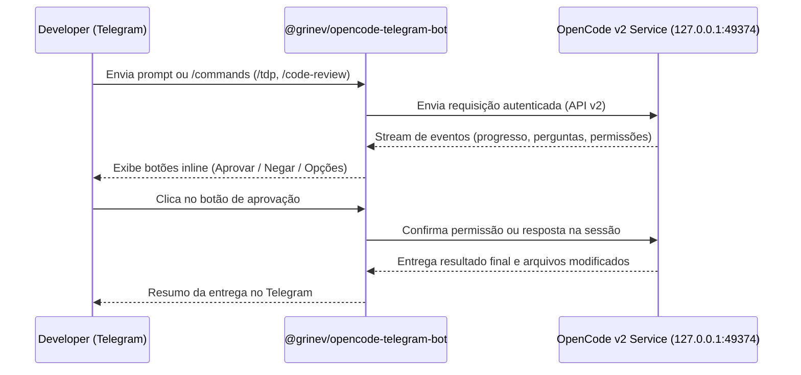

# OpenCode - Integração com Telegram (`@grinev/opencode-telegram-bot`)

Este guia documenta como controlar, monitorar e aprovar permissões do **OpenCode v2** remotamente pelo Telegram usando o cliente [`@grinev/opencode-telegram-bot`](https://github.com/grinev/opencode-telegram-bot).

---

## 🎯 Funcionalidades com OpenCode v2

- **Aprovação de Permissões e Perguntas:** Responda a perguntas do agente (ex: aprovações do `/tdp` e `/finish-task`) e aprove ou negue permissões de `shell`/`edit` diretamente no Telegram via botões inline.
- **Acompanhamento de Status em Tempo Real:** Mensagem fixada com projeto atual, branch/worktree, modelo, uso de contexto e lista de arquivos alterados, além do comando `/status`.
- **Delegação de Tarefas e Comandos:** Envie prompts em texto (ou voz) e execute nossos comandos customizados (`/tdp`, `/code-review`, `/finish-task`, `/release`, `/update-opencode`) e skills (`backend-code-review`) pelo menu inline (`/commands` e `/skills`).
- **Fila e Direcionamento (Queue / Steer):** No OpenCode v2, mensagens enviadas enquanto o agente está trabalhando podem entrar na fila (`Queue`) ou direcionar a tarefa em andamento (`Steer`).

---

## 🏗️ Arquitetura de Comunicação



---

## 🚀 Passo a Passo de Configuração (OpenCode v2)

### 1. Criar o Bot no Telegram e obter seu User ID
1. No Telegram, abra o [`@BotFather`](https://t.me/BotFather) e envie `/newbot`.
2. Escolha um nome e um username para o bot e copie o **Bot Token** gerado (ex: `123456:ABC-DEF...`).
3. Envie qualquer mensagem para o [`@userinfobot`](https://t.me/userinfobot) para descobrir seu **Telegram User ID** numérico (apenas esse ID terá permissão de interagir com o seu bot).

### 2. Iniciar o Serviço do OpenCode v2 e Obter a Senha
No OpenCode v2, todos os clientes (TUI, Desktop, Web e o Telegram Bot) conectam-se ao mesmo serviço local em background (porta padrão `49374`):

```bash
# Iniciar o serviço background do OpenCode v2
opencode serve --service

# Obter a senha gerada pelo serviço do OpenCode v2
opencode service get password
```

### 3. Instalar e Iniciar o Bot
Você pode executar diretamente via `npx` ou instalar globalmente:

```bash
# Opção A: Executar via npx (abre o assistente interativo na primeira execução)
npx @grinev/opencode-telegram-bot@latest

# Opção B: Instalar globalmente e rodar como daemon
npm install -g @grinev/opencode-telegram-bot
opencode-telegram start --daemon
```

No assistente interativo (`opencode-telegram config`), selecione:
- **Idioma:** `pt` (Português)
- **TELEGRAM_BOT_TOKEN:** Token obtido no `@BotFather`
- **TELEGRAM_ALLOWED_USER_ID:** Seu ID numérico do Telegram
- **OpenCode Version:** `v2` (`OPENCODE_SERVER_VERSION=v2`)
- **OpenCode API URL:** `http://127.0.0.1:49374` (padrão da v2)
- **OpenCode Server Password:** Senha retornada por `opencode service get password`

---

## 📱 Principais Comandos no Telegram

| Comando | Descrição |
|---------|-----------|
| `/status` | Exibe saúde do servidor OpenCode v2, projeto ativo, branch, sessão e modelo |
| `/commands` | Lista e executa os comandos deste repositório (`/tdp`, `/code-review`, `/finish-task`, `/release`, `/update-opencode`) |
| `/skills` | Lista e executa skills instaladas (ex: `backend-code-review`) |
| `/sessions` | Lista, busca e alterna entre sessões ativas do OpenCode v2 |
| `/projects` | Alterna entre projetos locais registrados no OpenCode |
| `/worktree` | Alterna entre Git worktrees do repositório atual |
| `/goal` | Define um objetivo contínuo na sessão do OpenCode v2 |
| `/abort` | Interrompe a execução da tarefa atual |
| `/reload` | Recarrega configurações do OpenCode v2 sem reiniciar o servidor |

---

## 🔒 Boas Práticas de Segurança

- **Whitelist Obrigatória:** Sempre defina `TELEGRAM_ALLOWED_USER_ID` com seu ID pessoal. Mensagens de qualquer outro usuário são ignoradas.
- **Não exponha portas:** O bot usa *long-polling* com a API do Telegram e se comunica apenas via `127.0.0.1:49374` com o OpenCode v2 local.
- **Proteja o `.env`:** Nunca versione o arquivo `.env` contendo `TELEGRAM_BOT_TOKEN` ou `OPENCODE_SERVER_PASSWORD`.
