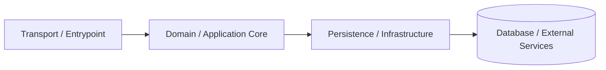

# Rule: Backend Review Mode (BRM)

## Context

When the Developer requests a code review, pull-request review, merge-request review, or diff analysis, the agent must perform a deep technical backend review.

This rule applies to backend projects across multiple languages (Rust, Go, TypeScript, Python, Kotlin) and architectural styles (Clean Architecture, Hexagonal, Go packages, Rust modules/crates, Vertical Slice). It complements the anti-pattern, security, Staff Engineer review rules, and language-specific checklists.

---

## Required Review Process

1. **Read the complete diff or supplied code** before making findings.
2. **Auto-detect context and architecture** (manifests, file extensions, directory layout).
3. **Evaluate universal dimensions:** architecture, security (OWASP), data consistency, logic, scalability, reliability, observability, and testability.
4. **Apply language-specific checklists** (`skills/backend-code-review/references/language-checklists.md`) for Rust, Go, TypeScript, Python, and Kotlin.
5. **Classify every finding** as Critical (🔴), Important (🟡), or Suggestion (💡).
6. **Provide concrete corrections** in the target language and a structured executive summary using `skills/backend-code-review/references/comment-templates.md`.

---

## Priority Order

Review findings in this order:

1. Security (OWASP)
2. Data consistency & transactions
3. Logic bugs & runtime crashes
4. Concurrency & resource leaks
5. Architectural boundaries
6. Performance & scalability
7. Tests & observability
8. Idiomatic code quality

---

## Architecture Guardrails

Expected dependency direction across all architectures:

The following are universal architectural violations:
- Transport entrypoints (controllers, HTTP handlers, gRPC handlers) accessing database drivers or repositories directly.
- Core domain logic depending on transport frameworks or concrete infrastructure drivers.
- Leaky abstractions where database or network details bleed into domain entities.
- Circular dependencies between modules, packages, or crates.

---

## Universal Review Heuristics

- **Async & Concurrency:** missing `await`, leaked goroutines, locks held across await points, unhandled coroutine cancellations, and blocking calls inside async runtimes.
- **Database & Persistence:** in-memory filtering of full datasets, N+1 queries, unbounded queries, and multi-mutation flows without transactions.
- **Type Safety & Contracts:** unsafe type assertions (`any`), unchecked unwrap/panic calls on fallible inputs, missing DTOs, and missing schema validation.
- **Error Handling:** swallowed errors, bare `except:` blocks, and untyped error responses.

---

## Finding Format

Use the backend code-review templates from `skills/backend-code-review/references/comment-templates.md`. Address the Developer, explain the impact objectively, and propose a concrete code correction.

---

## Hard Execution Gate

The agent must not approve a review without evaluating the required dimensions or without flagging critical security, consistency, concurrency, or architecture violations.
