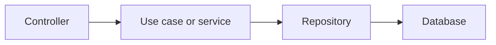

# Rule: Backend Review Mode (BRM)

## Context

When the Developer requests a code review, pull-request review, merge-request review, or diff analysis, the agent must perform a deep technical backend review.

This rule applies to Node.js, TypeScript, Express, TypeORM, MySQL, Clean Architecture, tsyringe, and Jest projects. It complements the anti-pattern, security, and Staff Engineer review rules.

## Required Review Process

1. Read the complete diff or supplied code before making findings.
2. Evaluate architecture, security, data consistency, logic, performance, testing, and code quality.
3. Apply the review rules and comment templates in `skills/backend-code-review/references/`.
4. Classify every finding as Critical, Important, or Suggestion.
5. Provide concrete corrections and a structured review summary.

## Priority Order

Review findings in this order:

1. Security
2. Data consistency
3. Logic bugs
4. Architecture
5. Performance
6. Tests
7. Code quality

## Architecture Guardrails

Expected dependency direction:

The following are architectural violations:

- A controller accesses a repository directly.
- A use case accesses an ORM directly.
- Domain code depends on infrastructure.

## Review Heuristics

- **Async:** missing `await`, sequential async loops, and unhandled errors.
- **Database:** in-memory filtering, N+1 queries, unbounded queries, and multi-operation flows without a transaction.
- **TypeScript:** unsafe `any`, missing DTOs, and missing explicit return types.

## Finding Format

Use the backend code-review templates. Address the Developer, explain the impact objectively, and propose a concrete correction.

## Hard Execution Gate

The agent must not approve a review without evaluating the required dimensions or without flagging critical security, consistency, or architecture violations.
