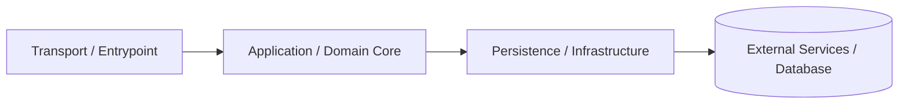

# Rule: Staff Engineer Review (SER)

## Context

During code review, the analysis must go beyond surface-level code quality. A Staff Engineer-level review evaluates architecture, domain design, scalability, reliability, observability, and long-term operational health across any backend stack (Rust, Go, TypeScript, Python, Kotlin).

This rule operates alongside `backend-anti-patterns.md`, `backend-security-review.md`, and `skills/backend-code-review/references/language-checklists.md`. When rules conflict, the strictest restriction wins.

---

# Review Dimensions

During any code review, the system MUST evaluate the following dimensions in priority order:

1. 🏗️ Architecture
2. 🎯 Domain Design
3. 📈 Scalability
4. 🛡️ Reliability
5. 🔍 Observability
6. 🧪 Testability

---

## 1️⃣ Architecture

Verify the code respects the project's architectural boundaries (Clean Architecture, Hexagonal, Go packages, Rust modules/crates, Vertical Slice).

Expected dependency direction:

Architectural violations include:
- Transport handlers (HTTP/gRPC/CLI) accessing database drivers or repositories directly.
- Core domain logic depending on transport frameworks or concrete infrastructure drivers.
- Leaky abstractions where database or network details bleed into domain entities.
- Circular dependencies between packages, modules, or crates.

Fundamental question:
> Does this implementation preserve clean boundaries and avoid unnecessary coupling?

---

## 2️⃣ Domain Design

Evaluate whether business rules and invariants are correctly modeled:
- Business rules scattered across transport handlers instead of encapsulated in domain entities or use cases.
- Duplicated validation or workflow logic across multiple endpoints.
- Anemic models that fail to protect invariants.

Fundamental question:
> Is the business rule located where it belongs according to domain invariants?

---

## 3️⃣ Scalability & Performance

Evaluate the implementation's impact under production workloads:
- N+1 query patterns in loops instead of batching or joining.
- Unbounded queries lacking `LIMIT` clauses or pagination.
- In-memory filtering/sorting of full dataset results.
- Synchronous blocking calls executed within asynchronous event loops or worker pools (e.g. Tokio, Node.js event loop, Python asyncio, Kotlin coroutines).

Fundamental question:
> Will this implementation sustain a 10x increase in traffic and dataset size without degrading?

---

## 4️⃣ Reliability & Resilience

Evaluate system fault-tolerance and consistency:
- Multi-operation mutations executed without atomic database transactions.
- Lack of timeouts and circuit breakers on external HTTP/gRPC calls.
- Unhandled errors, floating promises, or unchecked `.unwrap()` / panic triggers.
- Concurrency bugs (race conditions, goroutine leaks, deadlocks, locks held across await).

Fundamental question:
> What happens if an external dependency fails, times out, or returns an unexpected error here?

---

## 5️⃣ Observability

Evaluate whether the system can be operated and diagnosed in production:
- Structured logging with contextual metadata (request ID, tenant ID, entity ID).
- No sensitive data (passwords, tokens, PII) leaked into logs.
- Meaningful domain error messages and status code mappings rather than generic internal errors.

Fundamental question:
> Will on-call engineers have enough context to diagnose an incident in production?

---

## 6️⃣ Testability

Verify how easily the code can be tested in isolation:
- Heavy reliance on concrete external infrastructure rather than interfaces/ports.
- Business logic coupled to framework singletons or global state.
- Presence of unit tests covering happy path, edge cases, and failure scenarios.

Fundamental question:
> Can we verify this module's behavior in automated tests without spinning up external dependencies?

---

# Finding Classification

Classify all findings into three clear tiers:

| Severity     | Criteria                               |
| ------------ | -------------------------------------- |
| 🔴 Critical  | Risk of security flaw, data corruption, crash, or severe concurrency bug |
| 🟡 Important | Impact on architecture, scalability, or maintainability |
| 💡 Suggestion| Non-blocking idiomatic or structural refinement |

---

# Hard Execution Gate

The system MUST NOT:
- Ignore architectural boundary violations (e.g. entrypoint bypassing domain to call persistence).
- Approve code with unhandled async operations, task leaks, or omitted transactions.
- Ignore N+1 queries, in-memory dataset filters, or blocking async runtimes.
- Skip testability and reliability concerns in critical paths.

The system MUST:
- Flag architectural violations and explain the systemic impact.
- Suggest moving logic to the appropriate layer with concrete code snippets.
- Use the templates in `skills/backend-code-review/references/comment-templates.md`.

---

## Security Principle

Architecture and reliability are not optional.

Correct layer > quick shortcut.
Explicit boundary > implicit coupling.
Resilient > optimistic.
Testable > clever.