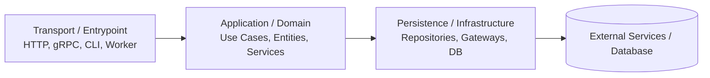

# Review Rules — Universal Backend Core

Universal standards for backend services across multiple languages and architectures.

---

# Target Languages & Stacks

- **Primary Languages:** Rust, Go, TypeScript / Node.js, Python, Kotlin
- **Ecosystems:** Cargo / Tokio, Go Modules, NPM / Node.js, Poetry / UV / Pip, Gradle / Maven
- **Common Architectures:** Clean Architecture, Hexagonal (Ports & Adapters), Idiomatic Go Packages, Rust Modular Crates, Vertical Slice, Layered MVC

---

# Architectural Boundary Model

Regardless of project architecture, dependencies must flow inwards toward the core domain, and transport/entrypoints must remain decoupled from storage and infrastructure details:

### Universal Boundary Rules
- **Entrypoints / Transport** (controllers, gRPC handlers, consumers) must NOT execute direct database queries or embody core business invariants.
- **Domain / Application Core** must NOT depend on transport frameworks (e.g. Express, Actix, Gin, FastAPI, Ktor) or concrete infrastructure drivers.
- **Persistence / Infrastructure** must adhere to domain interfaces / ports and avoid leaking storage-specific abstractions into business entities.
- **Circular Dependencies** between modules, packages, or crates are strictly prohibited.

---

# 🔴 Critical Problems (Block Merge)

## 1. Security (OWASP)
- **Injection:** Manually concatenated or interpolated SQL, commands, LDAP, or template queries.
- **Mass Assignment:** Passing raw incoming client payloads directly into database entities or ORM mutation methods without explicit DTO/schema filtering.
- **Broken Authentication / Authorization:** Missing auth middleware or permission checks on sensitive endpoints; public administrative operations.
- **Hardcoded Secrets:** API keys, tokens, passwords, or private keys committed in source code.
- **SSRF:** Unvalidated user-supplied URLs passed directly into outbound HTTP clients.

## 2. Data Consistency & Transactions
- **Multi-Mutation Without Atomic Transaction:** Executing multiple related write operations without an atomic transaction or Unit-of-Work boundary.
- **Race Conditions:** Concurrent read-modify-write cycles on shared state without appropriate synchronization (locks, mutexes, atomic operations, or database row-level locking).

## 3. Concurrency & Runtime Pitfalls
- **Goroutine / Task Leaks:** Spawning asynchronous tasks or goroutines without lifecycle bounds or cancellation contexts.
- **Locks Across Await / Yield:** Holding thread locks across asynchronous suspension points, leading to deadlocks or runtime thread starvation.
- **Production Panics / Unhandled Errors:** Unchecked unwraps/panics on fallible I/O, floating promises, or swallowed critical exceptions.

---

# 🟡 Important Problems (Fix in Current MR)

## 1. Performance & Scalability
- **N+1 Queries:** Executing database queries inside loops instead of batching, joining, or pre-fetching.
- **In-Memory Filtering:** Loading entire datasets or tables into application memory to perform filtering or sorting that should be executed by the database.
- **Unbounded Queries:** Missing pagination, limit clauses, or streaming on large or growing datasets.
- **Blocking Async Runtimes:** Executing synchronous, blocking I/O or heavy CPU-bound tasks inside async event loops or worker pools.

## 2. Code Quality & Modularity
- **God Functions / Classes:** Functions with excessive complexity, multiple responsibilities, or deeply nested logic.
- **Missing Data Transfer Objects (DTOs):** Passing database models directly across public API boundaries or vice-versa.
- **Duplicated Business Logic:** Invariants implemented redundantly across multiple entrypoints.

## 3. Testing Requirements
- **Untested Business Logic:** New or modified core domain rules and use cases without automated unit/integration tests.
- **Fragile Tests:** Unit tests depending on real network services or unseeded production databases instead of test doubles or isolated test containers.

---

# 💡 Suggestions & Improvements

- **Structured Logging:** Emit structured key-value logs instead of raw string interpolation.
- **Standardized Error Handling:** Use domain-specific error types or enums with consistent mapping to HTTP/gRPC status codes.
- **Defensive Copying & Immutability:** Prefer immutable data structures and explicit conversions over mutable shared references.