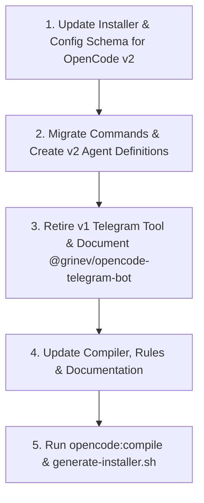

# TDD: OpenCode v2 Migration & Telegram Bot Integration

## Objective & Scope

- **What:** Migrate the repository's OpenCode configuration, commands, agents, compiler, installer, and documentation from OpenCode v1 to OpenCode v2 standards, and replace the broken v1 `tools/telegram-notify.ts` tool with documentation and setup guidance for `@grinev/opencode-telegram-bot` (v2 compatible).
- **Why:** OpenCode v2 introduces breaking changes in `opencode.json` schema validation (rejecting `"version": "1.0"`), instruction discovery (`rules/*.md` must be listed in `"instructions"` or compiled into `AGENTS.md`), command/agent YAML frontmatter (`subagent: true` vs `mode: subagent`, and `permissions` array with `edit`/`shell` actions instead of `tools`), TUI built-in `/update` command collision, and plugin architecture. Additionally, replacing the one-way `tools/telegram-notify.ts` with `@grinev/opencode-telegram-bot` enables full two-way Telegram interaction (remote permission approvals, Q&A, status tracking, and task delegation).
- **File Target:** `specs/tdd-opencode-v2-migration.md`

---

## Proposed Technical Strategy

### Logic Flow



1. **Installer & `opencode.json` v2 Schema (`installer.config`, `generate-installer.sh`, `dist/install-opencode.sh`)**:
   - Update `installer.config` to include `agents` in `DEFAULT_FOLDERS="agents commands rules skills docs"`.
   - Update `create_opencode_json()` in `generate-installer.sh`:
     - Remove the invalid `"version": "1.0"` key.
     - Configure `"instructions"` dynamically based on global vs. local installation context (`["~/.config/opencode/rules/*.md"]` for global, `[".opencode/rules/*.md"]` for local project) so OpenCode v2 automatically loads all Markdown rules.
     - Add v2 `"permissions"` rules for Git Governance safety (`git push --force*`, `git push -f*`, `git reset --hard*`, `git push * main*`, `git push * master*` with `"effect": "ask"`).
2. **Commands & Agents Migration to v2 (`agents/`, `commands/`, `skills/`)**:
   - Create `agents/code-reviewer.md` as a read-only OpenCode v2 subagent (`mode: subagent`) using v2 `permissions` (`action: edit -> deny`, `action: shell -> deny`).
   - Update `commands/code-review.md` frontmatter to use valid OpenCode v2 command fields (`description`, `agent: code-reviewer`, `model: opencode/big-pickle`, `subagent: true`), removing v1-only command frontmatter (`mode`, `temperature`, `tools`). Update rule paths in the prompt body so they resolve in root `rules/`, `.opencode/rules/`, or `~/.config/opencode/rules/`.
   - Update `commands/update-opencode.md` frontmatter to use `subagent: true` instead of `mode: subagent` and remove `tools: { bash: true }`.
   - Update `skills/backend-code-review/SKILL.md` to reference rule locations compatible with both local/global installs and root.
3. **Replace `tools/telegram-notify.ts` with `@grinev/opencode-telegram-bot`**:
   - Delete `tools/telegram-notify.ts`.
   - Remove `@opencode-ai/plugin` (v1 package) from `package.json`.
   - Create `docs/opencode/telegram-bot.md` documenting how to install and configure `@grinev/opencode-telegram-bot` with OpenCode v2 (`opencode serve --service`, `opencode service get password`, `OPENCODE_SERVER_VERSION=v2`, permission approvals, status checks, and task delegation).
4. **Compiler, Rules & Docs Update**:
   - Update `opencodecompile.sh` to include `agents` in `COMPILE_DIRS="agents commands rules skills"`.
   - Update `rules/95-opencode-compile-on-change.md` to trigger compilation on changes in `agents/`, `commands/`, `rules/`, `skills/`, or `.opencode/`.
   - Update `README.md`, `INSTALLER.md`, `docs/README.md`, `docs/opencode-config.md`, `docs/opencode/visão-geral.md`, and `docs/opencode/comandos.md` to:
     - Use `/update-opencode` instead of `/update` (avoiding collision with OpenCode v2's built-in `/update`).
     - Document the `agents/` directory and `@grinev/opencode-telegram-bot` integration.
5. **Artifact Compilation**:
   - Execute `npm run opencode:compile` to update `AGENTS.md`.
   - Execute `./generate-installer.sh` to regenerate `dist/install-opencode.sh`.

### Impacted Files

- **Created:**
  - `specs/tdd-opencode-v2-migration.md`
  - `agents/code-reviewer.md`
  - `docs/opencode/telegram-bot.md`
- **Modified:**
  - `installer.config`
  - `generate-installer.sh`
  - `dist/install-opencode.sh` (regenerated)
  - `opencodecompile.sh`
  - `package.json`
  - `commands/code-review.md`
  - `commands/update-opencode.md`
  - `skills/backend-code-review/SKILL.md`
  - `rules/95-opencode-compile-on-change.md`
  - `README.md`
  - `INSTALLER.md`
  - `docs/README.md`
  - `docs/opencode-config.md`
  - `docs/opencode/visão-geral.md`
  - `docs/opencode/comandos.md`
  - `AGENTS.md` (recompiled)
- **Deleted:**
  - `tools/telegram-notify.ts`

### Language-Specific Guardrails

- All shell scripts (`generate-installer.sh`, `opencodecompile.sh`, `dist/install-opencode.sh`) must maintain `set -euo pipefail` and valid Bash syntax (`bash -n` verification).
- Generated `opencode.json` must strictly conform to `https://opencode.ai/config.json` (OpenCode v2 schema).
- All documentation diagrams must use **Mermaid** only (`rules/55-mermaid-only-graphs.md`).

---

## Implementation Plan

### 1. `create_opencode_json` in `generate-installer.sh`

```bash
create_opencode_json() {
    local config_path="${INSTALL_DIR}/opencode.json"
    local instructions_glob=".opencode/rules/*.md"
    if [[ -n "$HOME_DIR" && "$TARGET_BASE" == "$HOME_DIR/.config" ]]; then
        instructions_glob="~/.config/opencode/rules/*.md"
    fi

    info "Creating opencode.json..."
    mkdir -p "$(dirname "$config_path")"

    cat > "$config_path" <<OPENCODE_JSON
{
  "\$schema": "https://opencode.ai/config.json",
  "instructions": [
    "${instructions_glob}"
  ],
  "permissions": [
    {
      "action": "shell",
      "resource": "git push --force*",
      "effect": "ask"
    },
    {
      "action": "shell",
      "resource": "git push -f*",
      "effect": "ask"
    },
    {
      "action": "shell",
      "resource": "git reset --hard*",
      "effect": "ask"
    },
    {
      "action": "shell",
      "resource": "git push * main*",
      "effect": "ask"
    },
    {
      "action": "shell",
      "resource": "git push * master*",
      "effect": "ask"
    }
  ]
}
OPENCODE_JSON

    success "opencode.json created"
}
```

### 2. New v2 Agent `agents/code-reviewer.md` and Updated Commands

`agents/code-reviewer.md`:
```yaml
---
description: Revisa código backend Node.js/TypeScript para qualidade, segurança e arquitetura sem alterar arquivos
mode: subagent
model: opencode/big-pickle
permissions:
  - action: edit
    resource: "*"
    effect: deny
  - action: shell
    resource: "*"
    effect: deny
---
```

`commands/code-review.md`:
```yaml
---
description: Revisa código para qualidade e melhores práticas
agent: code-reviewer
model: opencode/big-pickle
subagent: true
---
```

`commands/update-opencode.md`:
```yaml
---
description: Check for updates and update OpenCode AGENT configuration files (NOT application code)
subagent: true
---
```

### Path Resolution

- No root aliases used.
- Rule paths inside commands and skills will reference `rules/<file>.md` (or `.opencode/rules/<file>.md` / `~/.config/opencode/rules/<file>.md`).

### Naming Standards

- Work branch: `feat/bot-config-002-opencode-v2-migration`
- TDD file: `specs/tdd-opencode-v2-migration.md`
- All Markdown files use `kebab-case`.
