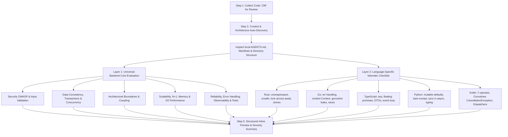

# TDD: Polyglot & Architecture-Aware Backend Code Review

## Objective & Scope

- **What:** Evolve the `backend-code-review` skill, its reference templates/rules, the `code-reviewer` subagent, and the backend review rules (`backend-anti-patterns.md`, `backend-security-review.md`, `staff-engineer-review.md`, `backend-review-mode.md`) from a single-stack TypeScript/Express/TypeORM review into a **2-Layer Polyglot & Architecture-Aware Backend Review System** supporting **Rust, Go, TypeScript, Python, and Kotlin**.
- **Why:** Backend projects across the organization use multiple languages (Rust, Go, TypeScript, Python, Kotlin) and diverse architectural styles (Clean Architecture, Hexagonal/Ports & Adapters, Idiomatic Go packages, Rust crates/modules, Vertical Slice, etc.). A single-stack ruleset causes false positives on non-TypeScript projects while missing critical language-specific defects (e.g., `.unwrap()` or lock-across-await in Rust, goroutine leaks in Go, blocking sync I/O in async Python, `!!` or broken Structured Concurrency in Kotlin). Keeping the skill named `backend-code-review` preserves backward compatibility and leaves room for a dedicated `frontend-code-review` skill in the future.
- **File Target:** `specs/tdd-polyglot-backend-review.md`

---

## Proposed Technical Strategy

### Logic Flow



1. **Architecture Auto-Discovery (Context-Aware Boundaries):**
   - Instead of hardcoding `Controller -> UseCase -> Repository` with `tsyringe` and `TypeORM`, the reviewer inspects the target repository's `AGENTS.md`, manifest (`Cargo.toml`, `go.mod`, `package.json`, `pyproject.toml`, `build.gradle.kts`, `pom.xml`), and directory layout.
   - Evaluates architectural boundaries **relative to the project's adopted pattern** while enforcing universal separation of concerns:
     - Transport/Entrypoints (HTTP handlers, gRPC servers, CLI, consumers) must not embed complex domain rules or direct raw database queries.
     - Core Domain/Business logic must not depend on HTTP transport details or low-level infrastructure drivers.
     - Circular dependencies and leaky abstractions are flagged regardless of stack.
2. **Layer 1 — Universal Backend Core (`references/review-rules.md` & `rules/backend-*.md`):**
   - **Security (OWASP):** SQL/Command injection (string interpolation in queries/commands), Mass Assignment (binding untrusted request payloads directly to persistence models), SSRF, Hardcoded Secrets, Broken AuthN/AuthZ, Path Traversal.
   - **Data Consistency & Concurrency:** Multi-step mutations without atomic transactions/unit-of-work, race conditions, deadlocks, missing idempotency on critical writes.
   - **Performance & Scalability:** N+1 query patterns, unbounded queries (missing pagination/limits), in-memory filtering of dataset queries, blocking I/O inside async event loops/runtimes.
   - **Reliability, Observability & Testability:** Swallowed errors, missing timeouts/retries on external network calls, unstructured logs or sensitive data (PII/secrets) in logs, and missing unit tests for core business rules.
3. **Layer 2 — Language-Specific Checklists (`skills/backend-code-review/references/language-checklists.md`):**
   - Dedicated sections loaded according to the file extensions in the diff (`.rs`, `.go`, `.ts`/`.js`, `.py`, `.kt`/`.kts`).
4. **Polyglot Comment Templates (`skills/backend-code-review/references/comment-templates.md`):**
   - Update templates so code blocks use the reviewed file's language (`<lang>`) rather than hardcoded `ts` / TypeORM snippets.

---

## Impacted Files

- **Created:**
  - `specs/tdd-polyglot-backend-review.md`
  - `skills/backend-code-review/references/language-checklists.md`
- **Modified:**
  - `skills/backend-code-review/SKILL.md`
  - `skills/backend-code-review/references/review-rules.md`
  - `skills/backend-code-review/references/comment-templates.md`
  - `agents/code-reviewer.md`
  - `commands/code-review.md`
  - `rules/backend-anti-patterns.md`
  - `rules/backend-security-review.md`
  - `rules/staff-engineer-review.md`
  - `rules/backend-review-mode.md`
  - `AGENTS.md` (recompiled via `npm run opencode:compile` after implementation)

### Language-Specific Guardrails

- All diagrams in documentation, rules, and skills must use **Mermaid** (`rules/55-mermaid-only-graphs.md`).
- No files outside `specs/tdd-polyglot-backend-review.md` are modified before explicit Developer approval.
- Immediately after updating `agents/`, `commands/`, `rules/`, and `skills/`, `npm run opencode:compile` must be executed (`rules/95-opencode-compile-on-change.md`).

---

## Implementation Plan

### 1. Workflow in `skills/backend-code-review/SKILL.md`

```text
Step 1 — Collect code for review (diff, files, snippet, or branch)
Step 2 — Detect project context (language from file extensions + architecture from local AGENTS.md / directory layout)
Step 3 — Apply Layer 1: Universal Backend Review Rules (references/review-rules.md + rules/backend-*.md + rules/staff-engineer-review.md)
Step 4 — Apply Layer 2: Language-Specific Idiomatic Checklist (references/language-checklists.md for Rust, Go, TypeScript, Python, Kotlin)
Step 5 — Generate structured inline preview (references/comment-templates.md)
Step 6 — Generate executive review summary (Critical, Important, Suggestions, Top Issues, Recommended Actions)
```

### 2. Structure of `skills/backend-code-review/references/language-checklists.md`

- **Rust (`.rs`):**
  - 🔴 Critical: `.unwrap()` / `.expect()` on fallible runtime inputs, `MutexGuard`/`RwLock` held across `.await`, unsound `unsafe` blocks without safety invariants, blocking syscalls/I/O inside async `tokio` tasks.
  - 🟡 Important: Unnecessary `.clone()` / allocations in hot loops, stringly-typed errors instead of typed `Result<T, E>` (`thiserror`/`anyhow`), unbounded channels (`mpsc::unbounded_channel`) without backpressure.
- **Go (`.go`):**
  - 🔴 Critical: Ignored errors (`_ = fn()`), goroutine leaks (unbounded goroutines without `context.Context` or exit channel), race conditions on shared maps/slices/structs, missing `resp.Body.Close()` or `rows.Close()`.
  - 🟡 Important: Missing `context.Context` propagation in I/O calls, `defer` inside loops, error wrapping without `%w`, pointer/interface nil-check pitfalls.
- **TypeScript / Node.js (`.ts`, `.js`):**
  - 🔴 Critical: Unhandled/floating Promises (missing `await`), `any` or unsafe type assertions (`as unknown as T`) bypassing validation, mass assignment (`req.body` persisted directly), Event Loop blocking operations.
  - 🟡 Important: Sequential `await` inside loops when `Promise.all` / bounded concurrency applies, missing DTO/schema validation (Zod/Joi/class-validator), missing explicit return types on module boundaries.
- **Python (`.py`):**
  - 🔴 Critical: Mutable default arguments (`def fn(items=[])`), bare `except:` or silent `except Exception: pass`, blocking synchronous I/O (`requests`, `time.sleep`, sync DB drivers) inside `async def` coroutines.
  - 🟡 Important: ORM N+1 lazy-loading inside loops (missing `selectinload`/`joinedload`/`select_related`), missing type hints on public functions/DTOs (Pydantic/dataclasses), resource leaks (files/connections opened without `with` context manager).
- **Kotlin (`.kt`, `.kts`):**
  - 🔴 Critical: Not-null assertion operator (`!!`) in production flows, catching generic `Exception` inside Coroutines without rethrowing `CancellationException`, launching coroutines on `GlobalScope`, blocking I/O on `Dispatchers.Default` or `Main` instead of `Dispatchers.IO`.
  - 🟡 Important: Exposing mutable collections/state (`var` / `MutableList`) across boundaries instead of immutable views, missing `use {}` on `Closeable` resources.

### Path Resolution

- Skill internal references use relative paths from `skills/backend-code-review/` (`references/review-rules.md`, `references/language-checklists.md`, `references/comment-templates.md`).
- Cross-references to `rules/` support `.opencode/rules/`, `~/.config/opencode/rules/`, and root `rules/`.

### Naming Standards

- Work branch: `feat/bot-configs-003-polyglot-backend-review`
- TDD file: `specs/tdd-polyglot-backend-review.md`
- New skill reference file: `skills/backend-code-review/references/language-checklists.md`
